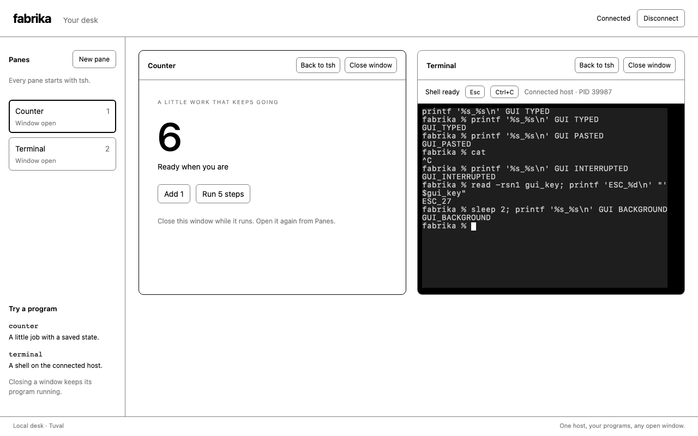

# The same desk on a Linux Sandbox

```text
Browser: Ghostty + React windows
  -> Access verifies the person
  -> Worker selects that person's Durable Object
  -> Linux Sandbox runs the Fabrika host, tsh and native Bash
  -> R2 keeps a saved /desk directory for replacement
```

The local desk from 130 now has a Ghostty renderer and a separate private
Sandbox deployment. The local browser checks and Linux runtime checks passed.
Authenticated cloud interaction and an actual R2 replacement passed. The
controller stopped the old instance, a different Linux VM restored the saved
file with the same SHA-256, and the counter returned at its saved value.

The hosted proof used library revision `806a9c7`. Ghostty is 0.4.0, Sandbox is 1.0.1,
and Wrangler is 4.151.1. Tests used Node 26.2.0 locally and 26.12.0 in Linux.
No model call was made. Model spend was $0; cloud infrastructure is billed
separately and was not measured as dollars in this run.

## What changed

The Elm answer remains the parent pane record in 130. A program's machine,
inputs and lifetime did not move into React. The renderer changes at the
existing Terminal window boundary. The same host supports loopback by default
and a configured exact HTTPS origin and path behind the cloud gateway.

| Piece | Owns |
|---|---|
| `programs/terminal/src/use-terminal.ts` | Ghostty initialization, input/resize callbacks, display lifetime and readable output. |
| `apps/browser-desk/src/server.ts` | The existing Fabrika programs and one browser socket, with validated hosting configuration. |
| `apps/sandbox-desk/src/access.ts` | RS256 Access verification, exact issuer/audience, approved-owner selection and header stripping. |
| `apps/sandbox-desk/src/worker.ts` | One Sandbox and R2 prefix per verified owner, lifecycle state and saved reference. |
| `apps/sandbox-desk/src/runtime.ts` | The container's private gateway and stopping/reopening the program host for a consistent directory save. |
| `apps/sandbox-desk/src/saved.ts` | Save ordering and retaining recovery data when a step fails. |
| `apps/sandbox-desk/build.ts` | Linux host, SQLite-worker and browser artifacts, without copying a macOS dependency tree. |

The hook uses the core rendering approach in
[Wormhole at `dc852695`](https://github.com/usirin/wormhole/tree/dc8526958b3ef4f2903e17aa1b4e83c5951aaf06/packages/ghostty-react).
Its optional WebSocket wrapper was not added. Fabrika retains its existing
typed connection. Ghostty's WASM changes browser emulation, not the location
of the native shell.

The deployed route sits beside the existing desk. Its existing Access gate
is reused. The old Worker, user controllers, logins and backups were not
replaced. New opaque owner IDs select fresh disks in the new deployment.
The two-person map is a secret generated outside the public checkout.

## Observed checks

All ten retained real-browser journeys passed with Ghostty: native typing and
clipboard paste, Ctrl-C, one Escape, hide/reopen, fresh attach, no-viewer counter
progress, 320-pixel layout, host-crash recovery of hidden work and refused
invalid inputs. Existing test expectations were retained; only renderer
selectors and readable-output lookup changed.

A separate Linux image check used the real Node host, SQLite worker and
native PTY. Unauthenticated gateway requests returned 403. A command printed
`LINUX_PROOF_Linux` and wrote a workspace file. Stopping and reopening the
host kept the Terminal pane and file, and started a different shell PID.
The existing image's Claude Code binary answered its version command without
any login or model call.

The full repository checks passed: typecheck, lint and 142 test files with
2,200 tests. Six added focused cases cover origin/header boundaries,
duplicate-owner refusal, failed R2 upload, failed reference commit, and
commit-before-destroy ordering. The failure checks call the same save function
as the live controller. They are not a substitute for a real R2 replacement.

The deployed configuration has one named Linux image, an isolated R2 bucket,
and only the new path route. `workers.dev` and preview URLs are disabled.
Anonymous requests to the route reach Access login. After sign-in, native
terminal input and browser clipboard paste worked. A counter advanced from 1
to 5 while its view was disconnected. Save and sleep completed, and the
controller reported `phase: sleeping`, `running: false`, with no failure.
Reconnect restored the pane records, counter value 5, a saved text file and
existing workspace directories. The kernel boot UUID changed; the text file's
SHA-256 was identical. Linux PIDs repeated across the two VMs, so they were
not used as proof of replacement. The saved result records the hashes.

The [recorded results](./results/131-ghostty-sandbox-desk.json) distinguish the
local and deployed checks. The image below is the local Ghostty desk, not an
authenticated cloud screenshot.



## Failures retained

The first Ghostty journey timed out on readable terminal output. Its canvas
had rendered the prompt. Inspection of 0.4.0 found that `onRender` is declared
but never fired. Reading the parsed buffer after write callbacks made the
same browser journey pass. Initialization failure is visible in the window.

The first bundled Linux host omitted `sqlite-worker.ts`, which the ledger
starts beside its module. The real image check failed with a missing-module
error. The image builder now bundles that worker beside the host.

The next Linux readiness check received 403 while the host was ready. The
same request made through Node's HTTP client returned 200. Node 26's `fetch`
ignored the supplied Host header. The trusted internal probe now uses the
HTTP client, as the proxy already does. The full Linux interaction then passed.

The first cloud dry run rejected `max_instances` for Durable Object-managed
containers. That legacy setting was removed. The verified two-owner map is
the only source of desk IDs. The first deployment attempt selected Wrangler's
default identity from the generated configuration folder; it could not access
the target account. Explicit selection of the verified profile deployed the
new Worker and image successfully. No old deployment was changed by the failed
attempt.

## What this cannot tell us

The second person's live isolation, real agent sessions and credential refresh
have not been checked on this new deployment. The previous private cloud
experiments are references, not evidence that the new desk passed those cases.

A save stops native processes; it preserves files and durable program state,
not memory or terminal scrollback. This preview saves and sleeps after 30
minutes without browser clients unless a counter job remains active. Long
shell commands need a connected view. Platform failure can lose changes after
the last successful save. Reparented daemons are outside the gateway's tracked
descendants. Backups keep old complete objects; retention/garbage collection is
not implemented here. Screen-reader output is available, but no assistive
technology journey was run.

The default fresh Node-base Docker build was not exercised. This Linux proof
reused the existing trusted development image and its pinned Sandbox shim.
Dynamic installed-window discovery, the full tsh readline experience, agent
chat windows, and moving the workshop into the final package layout remain
outside this experiment. Nothing was pushed or merged.
