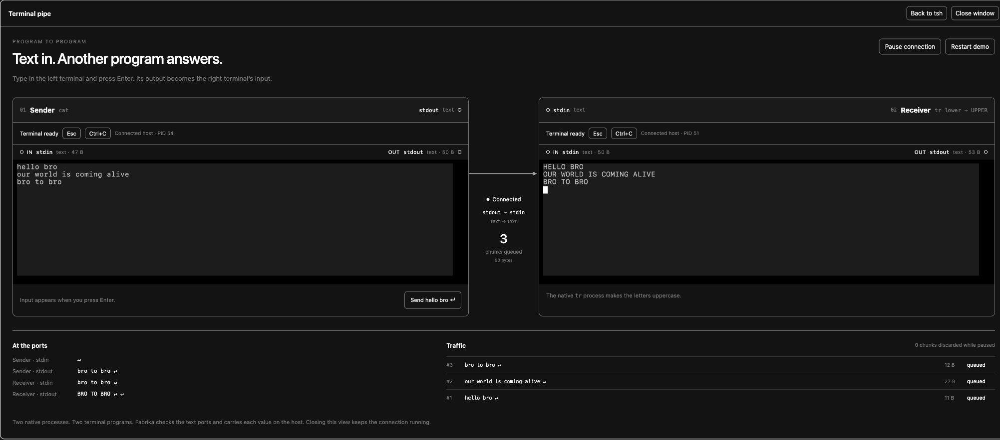

# Watching real terminal pipes

```text
Type a line in Terminal 1, then press Enter:
cat stdout -> Fabrika text link -> tr stdin
hello bro                            HELLO BRO
```

Two native terminal programs now communicate through Fabrika's public `pipe`
API. Their React window shows the connection, port values and actual traffic.
Local browser checks, an amd64 Linux container check, and the authenticated
cloud interaction passed. The saved pipe pane also returned in a different
Sandbox VM with fresh native processes and empty traffic history.

This is a small composition inside the existing GUI, not a graph editor or a
new transport. It uses the program contract already in the library. Model
spend is $0. Infrastructure charges were not measured.

## What connects

The Elm answer is explicit state for the session and for the pausable link.
Native process work lives in the programs; React only displays state and sends
validated input. The relevant Terminal interface is:

```ts
inputs: {
  action: input(Message, "Keyboard text or a resize."),
  stdin: input(Schema.String, "Text written to the native process."),
},
outputs: {
  stdout: output(Schema.String, "Text read from the native PTY."),
}
```

The receiver starts first. A link program starts with its text output wired to
the receiver's stdin. The sender then starts with its stdout wired to the
link. This attaches listeners before a process can produce text. The actual
composition is in `apps/browser-desk/src/terminal-pipe.ts`.

The sender runs `cat`; the receiver runs `tr '[:lower:]' '[:upper:]'`. Both
run through the same native PTY program as a normal Bash window. The
uppercase conversion happens in `tr`, not in React. PTY text includes terminal
control characters and may arrive in chunks that do not match whole lines.

The link's small machine records these events:

```ts
type Event =
  | {type: "input"; text: string; bytes: number}
  | {type: "queued"; id: number}
  | {type: "enabled"; enabled: boolean};
```

While enabled, it forwards the original text, then marks the recorded chunk
queued. While paused, it consumes new text, records it as discarded, and sends
nothing onward. Resuming forwards future text. There is no paused backlog.
This extra program is needed because the current `pipe` API wires at startup;
it has no detach operation. It keeps both native processes alive during pause.

## What the window shows

Type `pipe` in tsh, or use **Open terminal pipe**. Type on the left and press
Enter, or use **Send hello bro**. Native echo is disabled so the line appears
when `cat` reads and writes it.

The view shows both terminal programs, their typed IN/OUT ports, byte counts,
the latest value at each port, and the last 24 chunks at the link. A packet
crosses the wire when the forwarded count increases. The log and counts remain
available with reduced motion. A queued value means it was accepted by the
output path; the receiver's output is separate evidence of processing.

Closing the window or browser keeps the connection running. **Restart demo**
stops all three programs and starts fresh sessions. A host restart or cloud
save also starts new native processes. Terminal traffic is kept in memory,
not in SQLite or R2. Ordinary shell input is not copied into the port preview;
only this fixed `cat`/`tr` demonstration opts in to showing its input.

## Evidence

The native integration test sends text through the real program ports,
checks uppercase output, pauses and checks an actual discard, then resumes
and checks new output using the same session IDs.

All 14 real browser journeys passed. The four added journeys cover keyboard
input between native terminals and the visible wire; pause/discard/resume;
disconnect, close/reopen and reload; and process restart, reduced motion and a
320px layout. The prior counter, shell input/paste, Ctrl-C, Escape, host-crash
recovery and boundary-refusal journeys remain.

The Linux image check used the protected gateway and real amd64 `cat`/`tr`
processes. It verified forwarding, no forwarding or backlog while paused,
same-session resume, and new sessions after stopping/reopening the host.
Unauthenticated gateway access returned 403. Typecheck, lint and the complete
suite passed: 143 test files and 2,201 tests.

In the authenticated cloud browser, pasted text appeared in uppercase on the
receiver. Paused text produced a discard record and never reached the
receiver, including after resume. Session UUIDs stayed the same across pause,
resume and browser reload. Save and sleep completed with no running instance.
After reconnect, a different kernel boot UUID, new native session UUIDs, the
same pipe pane, an empty receiver and counter value 5 were observed. The saved
text file retained its SHA-256 and the existing directories remained. New
input crossed the restored connection successfully. Anonymous requests still
redirected to Access; alternate Worker URLs remained disabled. The original
desk's settings were unchanged.

The [result file](./results/132-visible-terminal-pipes.json) separates local,
Linux-image and hosted evidence. Experiment 131 records the earlier completed
R2 replacement proof.



## Publication against newer main

The hosted observations above used the library at `806a9c7`. Publication moves
the preview into `apps/browser-desk` and
`apps/sandbox-desk`, keeps its recovery counter private, and leaves the newer
Electron app and Counter untouched. Terminal now declares the core's typed
`view` and its window takes `WindowProps`. These changes are checked locally
on the newer library. They do not change the already deployed instance.

The records were numbered 129 to 132 at publication to avoid the upstream
experiments written while the preview was being tested. The catalogue and
connection remain explicit app code, not installed-program discovery.

Fresh publication checks used Node 26.2.0 and the library at `d9f7088`.
All 14 browser journeys passed, with no page errors. The focused native and
boundary suites passed (4 files, 8 tests), as did typecheck, lint, the core
and pipeline builds, and the browser and cloud bundles. The rebuilt amd64
Linux image passed forwarding, pause/discard/resume, private gateway refusal
and host quiet/reopen with new native sessions. No cloud deployment was made.
The subsequent upstream commits through `4923f77` add experiments 127 and 128
and direction notes; they do not change the library or application code.

The cloud bundler locates SQLite's worker beside the public `sqlite` module.
That build step depends on the current source layout. The Linux check above
exercises the resulting bundle; it does not establish a published worker-asset
contract for other bundlers.

The fresh [desktop screenshot](./results/132-browser-current.png) and
[320px screenshot](./results/132-mobile-current.png) show the current branch,
separately from the historical cloud screenshot above.

An initial full suite with two workers timed out in two unchanged tests:
host monitoring and the pipeline's world search. It passed 2,235 tests and
failed those two deadlines. Both files then passed serially without changes
(27 tests; the affected tests took 1.2 s and 4.2 s). This is evidence of a
successful retry, not proof of why the first run timed out. No limit was raised.
The complete serial rerun passed: 152 files and 2,237 tests in 265.1 s.
Both existing promises held, with their planted breaks caught and no exam changes.

## Failure retained

A browser regression showed old lower screen rows after a host restart, even
though the new host sent only a fresh prompt. Linux can also repeat PIDs
between VMs, so a PID is not a session identity. The Terminal now assigns a
UUID to each native session and remounts its renderer when that UUID changes.
The new display must be cleared after fitting, before replaying output.
Clearing before fitting still failed the same regression; clearing after it
passed before any replacement keyboard input. This establishes the tested
ordering, not a diagnosis of Ghostty's internal memory management.

An initial browser assertion checked disabled controls before React had
applied the disconnect state. Waiting for that observable state fixed the
check without changing the product or extending its timeout.

## What this cannot tell us

This proves one text connection with a fixed demonstration, not arbitrary
installed-program discovery or drag-and-drop wiring. Animation shows the
latest observed transfer; the browser samples state and is not a packet
tracer for every chunk under load. Byte counts refer to UTF-8 terminal text,
not arbitrary binary streams.

The pipe and its log are not a durable message queue or a process checkpoint.
Slow readers and sustained high-volume output were not load-tested. A program
failure is visible in the view; general automatic supervision is outside this
composition. A second owner's live login, real agent sessions, credential
refresh and an assistive-technology journey remain untested.
