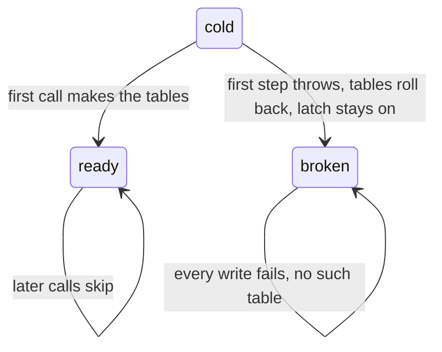
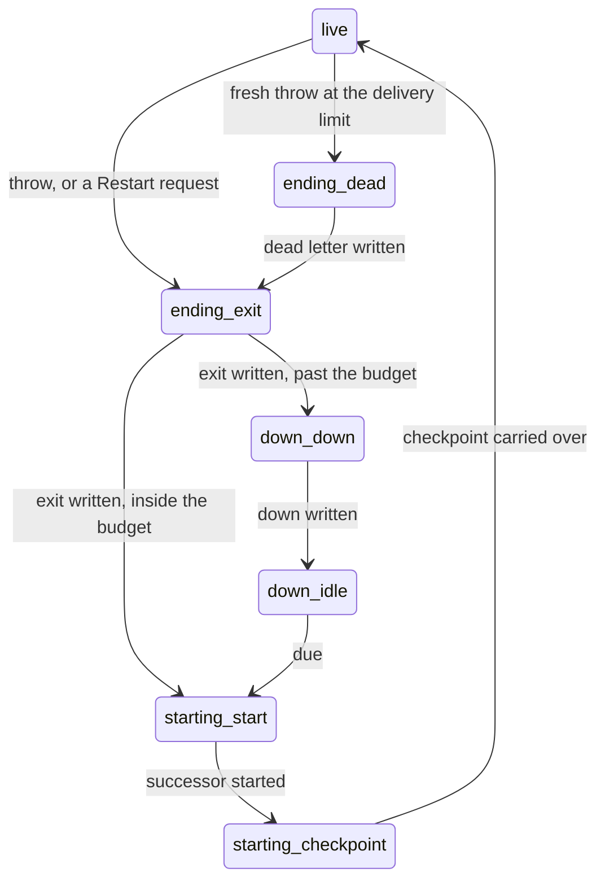
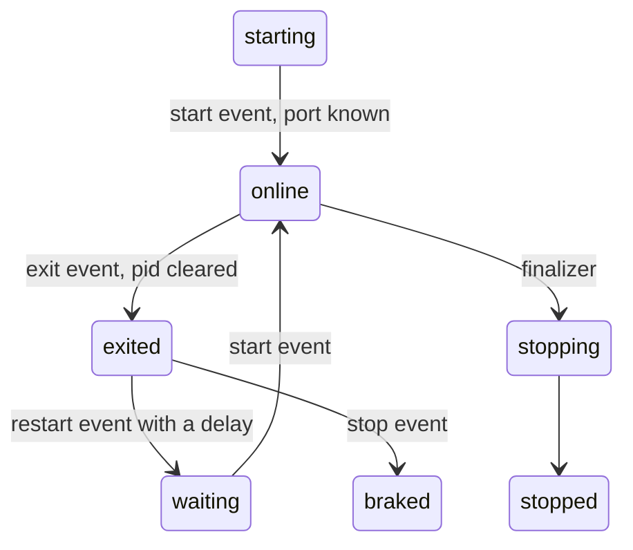
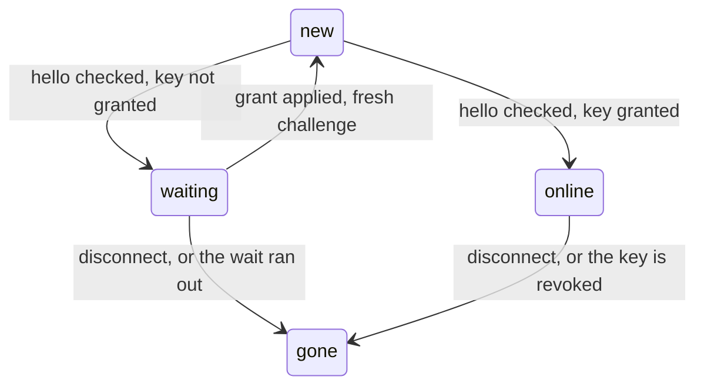
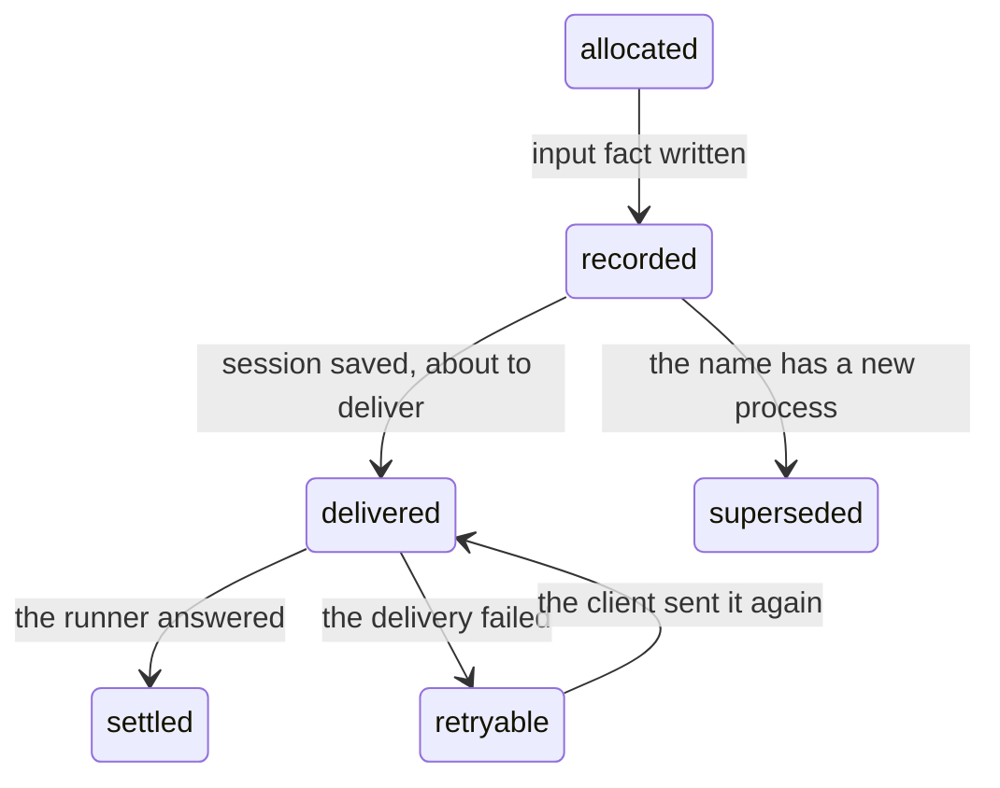

# 246. Which state machines in `next/` are implicit, and what form should each take?

Run 2026-11-09 on origin/main at `b865c421`. **All claims are about `next/`.** This is reading plus
counts, with one small probe script. No model was called, $0. 85 non-test source files under
`next/packages` and `next/apps` were swept (`exam/` skipped); 21 of them were read in full or in
their state-holding parts, the rest by search. The counts are in
[`results/246-implicit-state-machines-in-next.json`](./results/246-implicit-state-machines-in-next.json).

*Note, 2026-11-09, after this run: [0046](../.decisions/0046-one-tea-machine-per-file.md) removed
the plain form. Where this write-up names "a tagged union plus one transition function" as a form
(the T3 row, the Form column and each machine's Form paragraph), the form is now a tea machine. The
findings and counts stand as run.*

**The answer.** `next/` has 13 implicit state machines by the test below. One has a bug the probe
reproduces: the "tables made yet" latch in the span sink turns on before its transaction commits,
so one failed first write leaves the sink without tables until the process restarts. The three that
would prevent the most real bugs are the table latch (4 copies, 3 different rules), the supervision
record (24 state pairs allowed, 8 real, 5 runtime guards), and the connection handshake (two
writers, one in the gateway and one in the door). 12 more machines are already explicit, 5
step-by-step functions already have the right form, and 22 candidates are not machines. Made
explicit, the 13 would gain about 15 properties, which could stand in for about 65 of today's
example tests (a rough read of test titles), and leave 23 invariants for someone to write.

```ts
// The whole idea, as a sketch. Today (data/sink.ts:268): the latch flips inside the step.
sql.transaction(() => { if (!ready) makeTables(); ready = true; return step() })
// step() throws -> the tables roll back, `ready` stays true -> every later write fails.

// Explicit: one state, one transition, flipped only after the commit.
type Tables = "cold" | "ready"
const next = (s: Tables, committed: boolean): Tables => (committed ? "ready" : s)
```

## Method

### The definition

A thing has a state machine when both hold:

1. it stores a value that changes during its life, in response to events or calls;
2. that value decides which events or calls are legal next, or how the same one is handled.

This is **control state**. Harel's basic fragment of a state machine is the transition: "when event
α occurs in state A, if condition C is true at the time, the system transfers to state B" (Harel,
"Statecharts: a visual formalism for complex systems", Science of Computer Programming 8, 1987,
p. 232, read from the [scanned paper](https://www.state-machine.com/doc/Harel87.pdf)). UML's
tradition calls the rest **extended state**: plain data such as a count or a payload, which a guard
may read but which is not itself a state. That split is read here from the
[UML state machine article](https://en.wikipedia.org/wiki/UML_state_machine), sections "Extended
states" and "Guard conditions", which cite Selic, Gullekson and Ward, *Real-Time Object-Oriented
Modeling* (1994). The UML 2.5.1 specification itself (OMG formal/17-12-05) could not be opened in
this run, so no sentence here is quoted from it.

A machine is **implicit** when its control state is not one named type with its transitions in one
place: it is spread over several booleans, nullable fields, `let`s or call-order rules, so the
types allow combinations the thing can never rightly be in, or the transitions sit in several
places.

### The three tests, each yes or no

| Test | Question | What a "no" means |
|---|---|---|
| T1 | Does it store a value that changes during its life? | Not a machine: a setting, or a local of one call |
| T2 | Does that value decide what is legal next, or how a call is handled? | Not a machine: extended state |
| T3 | Must the state survive a restart of the process, or be seen by another party? | A tagged union plus one transition function in memory is enough |

A "yes" on T3 means the state has to be stored data that the recovery path reads: a ledger entry or
saved state, never a position in code and never memory only. A tea machine with Msgs is for when
events arrive over time, whatever T3 says.

Everything that passes T1 and T2 gets made explicit. The only choice is the form: one tagged union
with one transition function (the smallest proper machine), a tea machine, or OTP's shape where
`next/` follows OTP. Where this write-up thinks a machine that passes should still wait, it says so
as a disagreement with the rule.

### The three hiding places

Each machine below is tagged with where it hides:

- **flags**: control state spread over booleans, nullable fields or `let`s on one thing;
- **position**: a long function whose state is which step it has reached, so nothing stores it
  unless the code saves a marker;
- **between two parties**: a protocol whose order each side only assumes, split over two files.

### What tea's property tests check

Read from the installed `@demlik/tea` 0.25.0, `dist/pbt/index.d.ts`. Today's version imports
`@demlik/tea/pbt` in 46 files and `next/` in 3 (`app/brain-life.laws.test.ts`,
`next/programs/counter/src/program.laws.test.ts`, and one exam test).

- `arbMsgSequence` draws lists of Msgs, with a length bound and an optional fixed prefix.
- `arbGuidedSequence` draws lists in which every answer answers a Cmd that was sent and not yet
  answered. Its own docs say such a list never tests that a state refuses a Msg.
- `propertyTerminates` checks that every drawn list ends in a state the caller calls terminal.
- `propertyInvariant` checks a predicate on every step, given `{prev, msg, next, cmds}`.
- `propertyTrace` checks a predicate over the whole trace and the final state.
- Every runner takes `loaded`, a saved state to start from, which may itself be drawn.

`next/` also has its own replay law, `syncTest` in `testing.ts:17`: stop at every Msg, save through
JSON text, boot from it, and the rest of the run must match the run that never stopped. That is
the law "state rebuilt from what is stored equals the state in memory" for a tea machine.

A tea machine gets these as they are. A plain tagged union with one transition function needs a
small fast-check wrapper: draw a list of events, fold them, check a predicate per step. Per
[AGENTS.md](../AGENTS.md), a law is a property, or an example labeled `vector:`, `format:`,
`pinned:` or `scenario:`.

### The first counts, checked

| Sign | The brief said | Counted |
|---|---|---|
| Source files, no tests, no `exam/` | about 90 | 85 |
| `let` bindings | 63 | 56 |
| Boolean fields and annotations | 43 | 56 (24 are `Schema.Boolean`) |
| Files that import `@demlik/tea` | 9 | 8 |

Paths below are under `next/packages/libfabrika/src/` unless they start with `next/`.

## The 13 implicit machines

| # | Machine | Hides as | T3 | Allowed / real | Form |
|---|---|---|---|---|---|
| 1 | Table latch | flags, 4 copies | no | 2 / 2, wrong pairing reachable | one shared transition function |
| 2 | Supervision record | flags and position | yes | 24 / 8 | tea machine, inside P34c |
| 3 | A process's life, told twice | between two parties | yes | 12 / 5 | OTP: the supervisor learns by letter |
| 4 | Brain stage life | flags, between two parties | no | 32 / 6 | the tea machine that exists, read |
| 5 | Connection handshake | between two parties, flags | yes | 36 / 4 | tagged union, one writer; `gen_statem`'s shape |
| 6 | Input envelope | between two parties, position | yes | 60 / about 8 | tagged union, one transition function |
| 7 | Runner's process holder | flags | no | 48 / about 8 | tagged union in memory |
| 8 | Delivery receipt | flags | yes | 16 / 4 | tagged union |
| 9 | Member key standing | flags | yes | 8 / 4 | tagged union inside the fold |
| 10 | Membership change | position, flags | yes | 4 / 3 | one tagged row |
| 11 | Accepting one input | position | yes | stored in 3 places | stored already; one marker type |
| 12 | Running one Cmd | position | yes | 1 case, 3 real | stored already; add the missing cases |
| 13 | Span sink hold | flags | no | 4 / 3 | tagged union in memory (disagree, below) |

### 1. The table latch

**Where.** `let ready = false` in four places, each with its own rule:

- `data/sink.ts:259`, set at `:276` inside the transaction, before `step()` runs;
- `data/records.ts:247`, set at `:259`, the same way;
- `data/ledger-store.ts:172`, set at `:187` after its own transaction commits;
- `coordination/process-store.ts:107`, set at `:117` with no transaction of its own.

Two more stores have no latch and run `CREATE TABLE IF NOT EXISTS` on every call
(`coordination/gateway-manager.ts:55`, `coordination/session-manager.ts:117`).



**Tests.** T1 yes: it flips on the first call. T2 yes: it decides whether the tables are made.
T3 no: the tables are the stored fact, and the latch is a memory of them.

**The wrong state, reproduced.** The probe wraps node's SQLite so the first
`INSERT INTO unsent` throws once, as a full disk would, then ends four spans:

```text
after span 1 (write failed once): tables = []
after spans 2-4 (disk fine again): tables = []
errors on later spans: [ 'Error: no such table: health' ]
flush 1: SinkError {why: "storage", held: 4}
flush 2: SinkError {why: "storage", held: 4}
```

The sink never recovers in that process, though the disk is fine from the second span on. This ran
on `node:sqlite` through `data/sqlite.ts`. On a Durable Object it is a guess: its
`transactionSync` should roll back the same way, and a new isolate resets the latch.
`data/records.ts` has the same lines and was not run.

No test covers it today. `data/sink.test.ts` has four full-disk tests, and each lands one good span
first (`step("warm", {})`, or the span numbered 0) before the disk fills, so the tables always
exist by then.

**Form.** One function in `data/` that every store uses, with the latch flipped only after the
commit, as `ledger-store.ts` already does. A tagged union is not needed for two states; one
transition in one place is.

**Cost and gain.** About 4 files and 30 lines. It removes a reproduced failure and three of the
four rules. 90% sure.

### 2. The supervision record

**Where.** `Supervision` in `coordination/recovery.ts:98-118`. Its `recovery` is a tagged union of
four cases (`:51-56`), which is right. Beside it sit `pending`, an action whose `type` is one of
five strings (`:58-65`), `attempt` (`:105`) and `restart` (`:114`). The tea machine
`app/supervisor.ts:69` moves `recovery`, and knows three of the five actions. The runner edits
`pending` by hand in nine places: `app/runner.ts:374`, `:402-415`, `:429`, `:463-471`, `:516-520`,
`:565-593`, `:662-667`, `:713-719`, `:1537-1550`.



**Tests.** T1 yes. T2 yes: `resume` switches on `pending.type` (`app/runner.ts:341`). T3 yes: it
must survive a crash between any two writes, and it does. `RecoveryStore` saves it
(`app/runner.ts:259-265`) and `resume` reads it back (`:329-526`), with a fault cut after each step.
So the stored part is right. The shape is not.

**Allowed against real.** 4 `recovery` cases times 6 `pending` values is 24 pairs; 8 are real (the
nodes above, with `down` plus a carried-over checkpoint at `:662`). With `restart` and `attempt`
the type allows 96 and about 12 are real. The probe decoded three wrong pairs with the real schema
and all three passed: `live` with `dead`, `live` with `start`, `down` with `exit`.

**The wrong state.** Not reached by any path found. The code avoids it by care: five
`bad_row` guards exist only to catch a wrong pair (`app/runner.ts:348`, `:379`, `:424`, `:434`,
`:476`). If one were written, `continueRecovery` sets an alarm 100 ms out and fails again each time
(`:527-541`). That loop is a guess from reading, not run.

A second copy of one fact sits here too: "a step is in flight" is saved as `attempt`
(`app/runner.ts:745-753`) and again as `Activity.stepping` (`:756-758`), and `ensure` reads both
(`:678-683`).

**Form.** A tea machine, since it reacts to events over time (threw, exited, due, started), as
[Elm first](../docs/direction/elm-first.md) says. It is one already. Fold `pending` into the
`recovery` cases, so each node above is one case, and turn the runner's nine hand edits into Msgs
(`dead_written`, `exit_written`, `down_written`, `started`, `checkpointed`). Do it inside P34c,
which rewrites this machine anyway
([0016](../.decisions/0016-tier-1-supervision-is-otps-top-level-supervisor.md)). OTP's name for
the outer shape is the supervisor behaviour; the journal of durable steps is ours, because a
restart here is several writes.

**Cost and gain.** About 3 files and 200 lines, with saved rows to migrate. It removes 16 wrong
pairs and the five guards. 80% sure of the form; unsure how P34c's `failed` case changes the nodes.

### 3. A process's life, told twice

**Where.** The ledger's fold says `live`, `ended` or `down` (`coordination/process.ts:47-51`, folded
at `:245-327`). The runner's own SQLite says `live`, `ending`, `down` or `starting`
(`coordination/recovery.ts:51-56`). Two stores, two files, and `ensure` reconciles them: it asks
the ledger for `status` and adopts a successor the record did not know of
(`app/runner.ts:654-668`).

**Tests.** T1 yes, T2 yes, T3 yes: both are stored. 4 times 3 is 12 pairs; 5 are real.

**The wrong state.** The record says `down` and waits while the ledger already has a live
successor. This is reachable, and line `:661` exists to repair it.

**Form.** OTP's: a supervisor learns of a death by message and keeps no second copy of the child's
state ([supervisor behaviour](https://www.erlang.org/doc/system/sup_princ.html)).
[0020](../.decisions/0020-programs-get-hard-walls.md) already decides that the supervisor learns of
a crash by a letter. So this is not new work: P34c should leave one authority, the ledger's fold,
and keep in the record only the journal that machine 2 needs. 70% sure; the doubt is whether the
journal can drop `recovery.process` entirely.

### 4. The brain stage's life

**Where.** `node/stage.ts:91-99` holds `port`, `pid`, `previous`, `start`, `stopping`,
`replacement`, `reason` and `bytes` as `let`s. Line `:99` also holds `state`, the `brainLife` tea
machine (`app/brain-life.ts:35`). `state` is written at `:108` and never read: a search finds two
hits in the file, the declaration and the assignment. The code branches on the `let`s instead:
`port === 0` (`:117`), `stopping` (`:247`, `:340`), `start !== ""` (`:223`), `replacement !== null`
(`:211`, `:301`), `pid === 0` (`:340`).



**Tests.** T1 yes, T2 yes. T3 no for the `let`s: a new host process starts a new runtime. The one
fact that must survive, the last start id, is already stored by the outbox
(`node/local-stage.ts:91-99`, read at `node/stage.ts:93`).

**Allowed against real.** Five of the `let`s make 32 combinations; 6 are real, the six cases
`BrainState` already names. `exited` is missing from the machine: an `exit` event clears `pid`
(`:263`) and sends no Msg.

**The wrong state.** Between an `exit` and the next `start`, `port` still holds the dead runtime's
port, so `call` tries it and answers `unreachable` where `offline` was meant (`:117-118`). Read,
not run. [Experiment 244](./244-structure-sweep-on-next.md) found the stopping guard written three
times here (ticket 474), which is the same cause.

**Form.** The tea machine that exists, made the only state: `online` carries `port` and `pid`,
`waiting` carries the replacement, an `exited` Msg is added, and the code reads `state._tag`.
About 2 files and 80 lines. It removes 26 combinations and a machine nobody reads. 85% sure.

### 5. The connection handshake

**Where.** One connection's state is written by two parties:

- the gateway keeps `Attached` on the WebSocket: `new` at `workers/gateway.ts:224`, `waiting` at
  `:87-94`, `online` at `:100-109`;
- the door keeps its own `Attached` row under `client/<id>`: `waiting` at `door/door.ts:557-566`,
  `online` at `:607-618`, deleted at `:443` and `:700`, plus a `key/<id>` row (`:606`), a
  `door_pending` row (`:567`), the in-memory `checking` attempts (`:329`, `:466-486`) and the spent
  nonce (`door/nonce.ts:85-103`).



**Tests.** T1 yes, T2 yes: both sides gate methods on it (`transport/gateway.ts:118`,
`door/door.ts:420`, `:635`). T3 yes: the client is another party, and a hibernated gateway must
find it again. Both copies are stored. `checking` is memory only, and that is fine: a crash ends
the attempt, and the client dials again.

**Allowed against real.** 3 gateway cases, 3 door cases (absent, waiting, online), 2 for the key
row and 2 for the pending row is 36; 4 are intended.

**The wrong state, reachable today.** The gateway writes `waiting` whenever `initialize` is refused
and the hello decodes (`workers/gateway.ts:85-94`), also when the door refused with `bad_nonce` and
wrote nothing. The gateway then lets `door.knock` through, and only the door's own check answers
`not_waiting` (`door/door.ts:635`). Safe, because the door decides, but the two copies disagree.
Experiment 244 found the rule for calls before a hello decided twice and differently (ticket 472).

**Form.** One tagged union with one transition function, in `transport/`, and one writer: the door
answers the next `Attached`, and the gateway stores what it is given. `Attached` is the union
already. OTP's shape for a connection is `gen_statem`: "if we are in state S, and event E occurs,
we are to perform actions A, and make a transition to state S'"
([gen_statem behaviour](https://www.erlang.org/doc/system/statem.html)). Here that is the one
transition function; a tea machine is not needed, since each call is answered at once.

**Cost and gain.** About 4 files and 150 lines, in security code, so it needs its laws first. It
removes the second writer and 32 combinations. 70% sure; the doubt is whether the gateway may
depend on the door's answer for `new`, which it writes before the door has seen a hello.

### 6. The input envelope

**Where.** One input's state is in two stores. The door's `Binding.state` is a tagged union of five
cases (`door/door.ts:100-106`), moved at `:1233`, `:1310`, `:1361`, `:1397` and `:1404`. A sixth
state hides in a column: `letter = NULL` means "superseded by a newer delivery" (`:1198`). The
session manager keeps `recorded` or `delivered` for the same input
(`coordination/session-manager.ts:54`, moved at `:251` and `:290`), and "ended" in a table of its
own (`:130`).



**Tests.** T1 yes, T2 yes: `settled` answers from the saved result (`:1352`), and only `delivered`
may sign (`session-manager.ts:69`). T3 yes. Recovery reads the binding on a resend
(`door/door.ts:1171-1195`), so the position is not lost on a crash.

**Allowed against real.** 5 cases, 2 for the letter column, 3 session states and 2 for ended is 60;
about 8 are real. One query reads the state as text inside JSON (`:1138`).

**The wrong state.** A crash between `sessions.delivered` (`:1358`) and `saveBinding` (`:1363`)
leaves the session `delivered` and the binding `recorded`. A resend repairs it. Read, not run.

**Form.** One tagged union with one transition function, with `superseded` as a real case, and the
session manager's `recorded`/`delivered` read from it. About 3 files and 120 lines. 65% sure; the
doubt is whether the session manager must stay usable without the door.

### 7. The runner's process holder

**Where.** `app/runner.ts:209-230`: `store`, `process`, `supervision`, `woke`, `live`, `alarmAt`
and `retry`. `live === null` means "not loaded" (`:1090`). `supervision === null` means two things:
no recovery was wired (`:212-217`), or not loaded yet (`:628`). `alarmAt` has three values with
three meanings: `undefined` for unknown (`:1373`), `null` for none, a number for set (`:312`). The
question "is this process live" is asked nine times as `recovery._tag` against `"live"`.

**Tests.** T1 yes, T2 yes. T3 no: all of it is rebuilt from stored data by `load` (`:832-908`) and
`ensure` (`:620-735`).

**Form.** A tagged union in memory with one transition function: `unsupervised`, `loading`,
`loaded {live, retry}`, and `Alarm` as `unknown | none | at`. 48 combinations, about 8 real. No
wrong state was found. 1 file, about 100 lines. 75% sure.

### 8. The delivery receipt

**Where.** `Receipt` in `coordination/recovery.ts:82-96`: `input` (JSON or null), `digest`
(optional), `tries`, `errors` and `result` (null or dead). Made at `app/runner.ts:1599-1616`, moved
at `:1663-1670` (placed) and `:578-592` (failed, or dead).

**Tests.** T1 yes, T2 yes: a dead receipt refuses the input (`:1453`). T3 yes, and it is stored
inside the supervision record.

**Form.** A tagged union: `offered {input, digest}`, `placed {digest}`, `failing {input, errors}`,
`dead {input, errors}`. 16 combinations, 4 real; a filter (`:90-96`) already cuts some at run time.
`tries` always equals `errors.length` (`:583`) and can go. Best done with machine 2. 80% sure.

### 9. A member key's standing

**Where.** `coordination/members.ts`: `Key.live` (`:130`), the `spent` set (`:138`) and the
`replaced` set (`:149`). They move at `:214-222`, `:359-360` and `:375-376`. `standing` reads all
three in a fixed order to say why a signer is refused (`:236-257`).

**Tests.** T1 yes, T2 yes. T3 yes, and it is right already: the stored data is the member facts on
the ledger, and this is their fold.

**Form.** A tagged union on the key: `live | revoked | spent | replaced`. 8 combinations, 4 real,
since spent and replaced always stop the key too. Line `:356` checks `live` and "not spent", though
spent implies not live: the invariant is not trusted by its own author. `allows` is already the one
transition function. 1 file, about 40 lines, no wrong state found. 85% sure.

### 10. A membership change at the door

**Where.** `door/door.ts`: a `changePending/<id>` row (`:947-957`), then a `change/<id>` receipt
(`:970`). Recovery reads both (`:831`, `:899`, `:948`).

**Tests.** All three yes. Form: one row with a tagged state, `pending | applied {reply}`. 4
combinations, 3 real; the pending row is never removed. Small: 1 file, about 30 lines. 80% sure.

### 11. Accepting one input

**Where.** `accept`, `app/runner.ts:1561-1680`, hides as position: save a receipt (`:1599`), step
(`:1619`), save the `prepared` marker (`:1651`), append to the inbox (`:1652`), swap the receipt's
input for its digest (`:1663`), fold (`:1674`).

**Tests.** T1 and T2 yes. T3 yes, and the position is stored: `load` sees a saved turn (`:907`),
`catchUp` accepts the prepared letter (`:991`), and a restart carries it over (`:483-501`). It is
not lost on a crash.

**Form.** Stored already, which is the right form. What is implicit is that the position lies in
three places: the receipt, `checkpoint.turn` and the letters index. Machine 8's union names two of
its steps. No further change is proposed.

### 12. Running one Cmd

**Where.** `dispatch`, `app/runner.ts:1277-1345`: run the Cmd, take the permit, send the answer,
fold it. The stored state is membership in `cmds`, with `state: "dispatched"` as its only case
(`:91-98`).

**Tests.** T1 and T2 yes. T3 yes. On a load only saved writes are run again (`:894-896`). A handler
Cmd that was interrupted stays `dispatched` (`:1250-1253`) and is not run again. A test says it
"remains visible after wake" (`app/runner.test.ts`, "re-fire an unanswered dispatch"); where a
person or a program would see it was not read.

**Form.** Stored already. The union has one case where the life has three: `dispatched`,
`interrupted` (nobody knows whether it acted) and answered. Adding `interrupted` would give that
visible state a name. Whether a stuck handler Cmd is a real problem today is a guess; it was not run. 60% sure.

### 13. The span sink's hold

**Where.** `data/sink.ts:261-265`: `held` and `failed`, moved in `commit` (`:318-327`) and `flush`
(`:395-397`).

**Tests.** T1 yes, T2 yes: `flush` fails while either is set. T3 no. Held spans are lost if the
process dies, which nothing can fix while the disk is full.

**Form by the rule.** A tagged union in memory: `clean | holding {spans} | recovered`. 4
combinations, 3 real.

**Disagreement with the rule.** This one should wait. All four combinations are reachable and each
is handled the same way as a real one, so no wrong state is removed. Fix machine 1 in this file
first. 70% sure.

## What property tests each machine would get

"Covers" counts today's example tests whose whole point is a state or a transition, read from
test titles and not from each test's body, so every count is rough. Most of those tests also check
storage through the real runner or door, so a property over the pure machine would replace their
transition part, and few could be deleted outright.

| # | Runs as is, or needs a wrapper | Properties gained | Invariants to write | Covers (rough) |
|---|---|---|---|---|
| 1 | wrapper | 1 | 2 | 0 |
| 2 | tea: invariant, trace, terminates with guided lists | 3 | 4 | 15 |
| 3 | none: the second copy goes | 0 | 1 | 3 |
| 4 | tea: invariant, terminates | 2 | 3 | 1 |
| 5 | wrapper | 2 | 2 | 10 |
| 6 | wrapper | 2 | 3 | 7 |
| 7 | wrapper | 1 | 2 | 3 |
| 8 | wrapper | 1 | 2 | 5 |
| 9 | wrapper, and it exists | 0 | 0 | 6 |
| 10 | wrapper | 1 | 1 | 4 |
| 11 | replay law, and it exists | 0 | 1 | 3 |
| 12 | wrapper | 1 | 1 | 4 |
| 13 | wrapper | 1 | 1 | 4 |
| Total | | 15 | 23 | 65 |

Per machine: the invariants in one line each, the wrong states that stop being a test because the
type no longer allows them, and the replay law for those that pass T3.

1. **Table latch.** Invariants: "ready means the tables exist"; "a step that throws leaves the
   latch as it was". No state leaves the type. Covers 0: it adds the case nobody tests. T3 no.
2. **Supervision record.** Invariants: "no start before its `until`"; "one successor per exit";
   "a dead letter is written before its exit"; "the crash count resets only while live". The 16
   wrong pairs and the five `bad_row` guards stop being testable. Replay law: checked today for
   the machine's own three Cmds by `syncTest` (`app/supervisor.laws.test.ts`, "every saved cut
   resumes the same recovery"), and by example per cut in `app/recovery-gaps.test.ts` (6). The
   runner's hand edits (`dead`, `checkpoint`) are outside that law today. Covers: about 9 of the
   25 in `app/runner-supervision.test.ts` plus those 6.
3. **A process's life, told twice.** Invariant: "a name has at most one live process", on the
   ledger's fold. The law "the record agrees with the ledger" disappears with the second copy.
   Covers about 3 adoption tests in `app/runner-supervision.test.ts`.
4. **Brain stage.** Invariants: "no port, then `offline`"; "an exit clears the pid before any
   call"; "a stopped or braked stage never starts a replacement" (exists, `pinned:`, in
   `app/brain-life.laws.test.ts`). 26 combinations leave the type. That file's three laws,
   one of them the JSON replay law, run today against a machine the stage never reads. Covers 1
   (`node/stage.laws.test.ts`); the three in `next/apps/fabrika/src/brain-life.test.ts` are
   `scenario:` tests of process groups and stay.
5. **Connection handshake.** Invariants: "only an online connection routes a method other than
   `initialize` and `door.knock`" (exists as a property, `transport/answer.test.ts` d2); "a nonce
   goes online at most once". "The gateway's copy equals the door's row" stops being a test with
   one writer. Replay law: by example only, in `next/apps/fabrika/src/door.test.ts` ("survive
   reopening SQLite", "restarted connections"). Covers about 8 of its 13 handshake tests and 2 of
   10 in `transport/hello.test.ts`.
6. **Input envelope.** Invariants: "a settled input answers the same result on every resend";
   "only a delivered input signs"; "a superseded binding never delivers". The hidden `letter =
   NULL` state and the text query leave. Replay law: by example per state, in
   `next/apps/fabrika/src/door-recovery.test.ts` ("rebind only some states: ${state}"). Covers
   its 3 examples and about 4 in `door.test.ts` (p67, question 16).
7. **Runner's holder.** Invariants: "the alarm is the earlier of the program's wake and the
   recovery wait"; "no step runs while the process is not live". `supervision === null` stops
   meaning two things. Covers about 3 alarm tests in `app/runner-supervision.test.ts`. T3 no.
8. **Delivery receipt.** Invariants: "tries never pass the limit"; "a dead receipt always
   refuses". 12 of 16 combinations and the run-time filter leave. Replay law: one example,
   `coordination/recovery-store.test.ts` ("memory-only receipt"). Covers about 5 counting tests in
   `app/runner-supervision.test.ts`.
9. **Member key standing.** The properties exist: `coordination/members.test.ts` has 36 tests
   and already draws "over any list" ("at most one sheet is live at every step"). 4 of 8
   combinations leave, and about 6 of its "plant" examples on revoked, spent and replaced keys
   become cases the type cannot write. The fold is its own replay law.
10. **Membership change.** Invariant: "an applied change answers the same reply for the same
    bytes, and refuses other bytes". Covers about 4 of the p42 tests in `door.test.ts`.
11. **Accepting one input.** Invariant: "an input is in the inbox at most once, at its first
    placing". Replay law: checked today, by `app/runner-recovery.laws.test.ts` (1 property) and
    per cut in `app/runner.test.ts` ("trust a prepared model: recovery ${cut}"). Covers about 3.
12. **Running one Cmd.** Invariant: "a Cmd is answered at most once, and an interrupted handler
    is never run again". Covers about 4 of the 17 Cmd tests in `app/runner.test.ts`.
13. **Span sink hold.** Invariant: "unsent plus held is every span that ended". Covers the 4
    full-disk examples in `data/sink.test.ts`; the one on a real full file stays as a `scenario:`.

**The total.** About 15 properties gained, about 65 example tests whose transition part they could
cover, and 23 invariants still to write, of which 3 exist today in some form (machines 4, 5 and
9).

## Machines that are already explicit

These pass T1 and T2, and each is one named type with its transitions in one place.

- `State` of a process, a fold of ledger facts (`coordination/process.ts:47`, `:245-327`).
- `Activity`, idle or stepping (`coordination/process.ts:117`).
- `Content`, kept or deleted (`data/trace.ts:67`, `data/records.ts:335`).
- A record part, open or rolled (`data/records.ts:100-110`).
- A ledger turn, open or ended (`data/ledger-store.ts:420-460`).
- The door's own start id, unset or allocated (`door/door.ts:720-744`).
- An enrollment, issued or used (`door/door.ts:186`, `:980`).
- A watch, live or canceled (`coordination/process.ts:309-324`).
- A connection's `busy` mark (`transport/gateway.ts:123-131`, read at `:189`).
- A nonce, spent or not (`door/nonce.ts:85-103`).
- A saved descriptor, pending or configured (`workers/runtime.ts:382`, `:394`, `:528`).
- The waiting room, with `knock`, `leave` and `expire` on one class (`transport/waiting.ts:16`).

## Step-by-step functions whose form is already right

Position machines that never need to resume (T3 no), or that store their position.

- `startRuntime`, `node/stage.ts:322-333`: deploy, wait to listen, wait for the start. A new host
  starts over.
- `stopRuntime`, `node/stage.ts:218-236`.
- The WebSocket upgrade, `workers/gateway.ts:203-229`: a crash means the client dials again.
- `send` in the sink, `data/sink.ts:344-392`: its position is the `parts` row (`:372`, read `:350`).
- `start` and `configure` in the runtime, `workers/runtime.ts:380-395`, `:510-537`: the position
  is the `pending` column.

`ProcessManager.start` writes its two or three facts in one atomic turn
(`coordination/process-manager.ts:130-191`), so it has no position at all.

## Not a machine

Each line names the clause that failed.

- `personOnly`, 7 places (`door/door.ts:121`, `app/program.ts:68`, others): T1, a setting.
- `ok` on spans (`data/trace.ts:62`, `:87`): T1, a recorded fact.
- Passkey `be` and `bs` (`coordination/members.ts:51-52`, `transport/sshsig.ts:123-124`): T1.
- `typed` (`coordination/members.ts:75`) and `crossOrigin` (`transport/webauthn.ts:81`): T1.
- `Page.rolled` and `Lookup.absent.rolled` (`data/records.ts:30`, `:37`): T1, a copy in an answer.
- A gateway connection's `state` (`coordination/gateway-manager.ts:17`): T1, computed per call.
- `tabs` in a waiting row (`transport/waiting.ts:9`): T1, always `clients.length`.
- `Dispatched.state` (`app/runner.ts:94`): T1, one value that never changes (see machine 12).
- `watching` on a connection (`transport/wire.ts:47`): T2, set at `door/door.ts:679`, read nowhere.
- `brain.last.json` (`node/local-stage.ts:91-99`): T2, read once at start.
- The door's `count` (`door/door.ts:721`) and the sink's `dropped` (`data/sink.ts:88`): T2.
- `checked`, the sink's newest hour (`data/sink.ts:265`): T2, a watermark a guard reads.
- `restarts`, `crashes`, `healthyAt`, `seq` (`coordination/recovery.ts:102-113`): T2, extended
  state read by machine 2's guards.
- `Policy` and settings (`coordination/recovery.ts:12`, `next/apps/fabrika/src/settings.ts`): T1.
- The runtime's `policies` cache (`workers/runtime.ts:396`): T2.
- The gateway's `connections` cache (`workers/gateway.ts:34`): T2.
- The brain outbox (`node/local-stage.ts:29`): T2, a queue.
- `refusal`, `verified`, `enrollmentChecked`, `safe`, `processId` (`door/door.ts:804`, `:839`,
  `:1076`, `:1173`, `:1258`): T1, locals of one call.
- `model`, `view`, `wake`, `cmds`, `mine` in `catchUp` (`app/runner.ts:953-968`): T1, loop totals.
- `folded` in `replay` (`coordination/client-manager.ts:81`): T1, a fold's total.
- Loop counters (`coordination/recovery.ts:24-25`, `transport/binary.ts:31`, `id.ts:148-178`,
  `data/sink.ts:350-360`, `:416`, `app/state.ts:45`, `app/runner.ts:553`): T1.
- `let`s in test helpers (`testing.ts:38`, `coordination/process.test-support.ts:75-155`): T1.

## The ranking

1. **The table latch.** The only one with a reproduced failure, and the smallest change.
2. **The supervision record.** The most wrong pairs and the most hand edits, and P34c is about to
   rewrite it, so the right shape costs least now.
3. **The connection handshake.** Two writers in the code that decides who is let in.

60% sure of third place over the input envelope. A count of real resend and reconnect failures in
`field/` would settle it; none are recorded for `next/` yet.

## The probe

Not kept in git. It ran with plain `node` against the working tree, importing `SpanSink`
(`data/sink.ts`), `nodeSql` (`data/sqlite.ts`) and `Supervision` (`coordination/recovery.ts`):

```ts
// Sketch of the two checks.
const sql = { ...real, exec: (q, ...p) => {
  if (failOnce && q.includes("INSERT INTO unsent")) { failOnce = false; throw new Error("disk full") }
  return real.exec(q, ...p)
} }
// 1. End four spans under SpanSink.layer(sql, {object: "probe"}); list sqlite_master; flush twice.
// 2. Schema.decodeUnknownExit(Supervision)({...base, recovery, pending}) for three wrong pairs.
```

## What this cannot tell us

- Whether the latch bug happens on a Durable Object. It ran on `node:sqlite` only.
- Whether any wrong pair in the supervision record, the handshake or the envelope is reachable.
  They were read, not driven. Only the latch and the schema checks were run.
- How often any of this bites. There is no `field/` data for `next/` on resends, reconnects or
  restarts yet.
- How many example tests a property could really replace. The 65 is a read of titles; nobody
  opened each test to see what else it checks.
- What tea's `lawInvariant`, `lawTerminates`, `lawTrace` and `foldEvents` check. `pbt` re-exports
  them and they were not read.
- What UML 2.5.1 itself says. The split between control state and extended state is quoted from
  Harel and from a secondary article, not from the specification.
- Anything about `exam/`, tests, or today's version.
- The "allowed" counts are products of the fields named in each section. They leave out payload
  fields, so they are a floor, not an exact size.
- 64 of the 85 files were covered by search, not read whole. A machine hidden as position in a
  file with no `let`, no boolean and no tag check would be missed.
