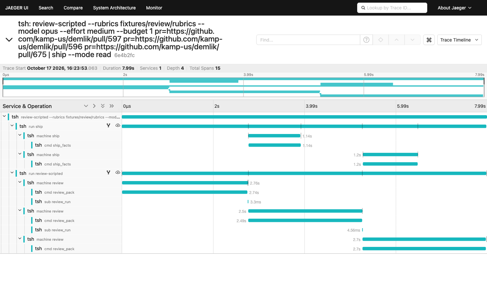

# 68. Tracing: one tsh line, one trace

```sh
# Docker Desktop running first
pnpm trace:up                                   # Jaeger in Docker: UI on :16686, OTLP/HTTP on :4318
TSH_TRACE=1 bin/tsh -c 'review-scripted --rubrics fixtures/review/rubrics --model opus --effort medium --budget 1 pr=https://github.com/kamp-us/demlik/pull/597 pr=https://github.com/kamp-us/demlik/pull/596 pr=https://github.com/kamp-us/demlik/pull/675 | ship --mode read'
open http://localhost:16686                     # Service: tsh, Find Traces, the line is the top one
pnpm trace:down
```



## What we asked

Can the owner type one tsh line, open a browser, and see the whole run as
one trace tree: the line, each program run, the pipe between them, each
machine's Msgs and Cmds, and the review agent's turns and tool calls? With
Effect's own tracing, OpenTelemetry's names, nothing changed in
`@demlik/tea`, and no cost when it is off.

## What was built

| Piece | Where | What |
|---|---|---|
| The line span | `src/tsh/execute.ts` | Each pipeline a tsh line runs is a span named by the line as typed. Its trace is `runTraceId(<first stage's run id>)`, so `attach` of that job later opens a span in the same trace. |
| The run span | `src/program/program.ts` | `start` opens `run <program>` with `tea.program.name` and `tea.run.id`, under the current span. With no current span, its trace is `runTraceId(<run id>)`. Each value told is an event `told <input>`; each value sent, `sent <output>`. |
| The pipe link | `src/program/program.ts` | `pipe` links the two run spans both ways, with `tea.pipe.output` and `tea.pipe.input`. |
| Machine spans | `src/program/trace.ts` | `runTraced(name, machine, opts)` is tea's `run` plus spans: `machine <name>`, a child span per Cmd (`cmd <type>`, with `tea.cmd.outcome`), a child span per Sub (`sub <type>`), and an event per Msg (`msg <type>`). review, ship and tally use it. ship's read mode steps its machine by hand (`look.ts`), so it writes the same names there, and the Cmd it would send next is an event with outcome `not_sent`. |
| PR attributes | `src/stages/traced.ts` | A machine for one pull request carries `vcs.repository.url.full` and `vcs.change.id`, OpenTelemetry's names for them. |
| The agent bridge | `src/trace/agent.ts` | tea's `agentSpans` (in `@demlik/tea/otel`, by its author) writes the agent's spans with the raw OpenTelemetry tracer of the same provider Effect writes with, parented to the Effect span current where the agent starts. |
| SDK messages as agent events | `src/trace/sdk-events.ts` | The live reviewer runs on the Claude Agent SDK, not tea's agent runtime. A fold turns its messages into tea's `AgentEvent`s, decoded with Effect `Schema`, carrying names, ids and token counts only. The live reviewer feeds it through its `seen` hook when tracing is on. |
| Export | `src/trace/otel.ts`, `src/tsh/main.ts` | `@effect/opentelemetry`'s `OtelTracer.layer` over one `BasicTracerProvider`, OTLP/HTTP batched to `TSH_TRACE` (`1` is `http://localhost:4318`, a url is that collector). Off: no provider, no exporter, and `Effect.withTracerEnabled(false)`, so every span is a no-op. |
| Viewer | `package.json` | `trace:up` runs `jaegertracing/all-in-one:1.76.0` as `tsh-jaeger`; `trace:down` stops it (`--rm`: nothing left behind). |

Values never go into a span: tags, names and ids only. What tea's
`agentSpans` would export of a prompt, a turn's text, a tool's input or
result is masked to `[not exported]`, and the SDK fold never carries them in
the first place.

## The trace tree

`review-scripted … pr=1 pr=2 pr=3 | ship --mode read`, pull request 2 a
draft. From the test, on recorded GitHub answers, in an in-memory exporter
(`src/tsh/trace.test.ts`). The live run on 597, 596 and 675 has the same
shape, and 675 really is a draft.

```
review-scripted … pr=…/1 pr=…/2 pr=…/3 | ship --mode read            the line (root)
├─ run ship                     ↔ link to run review-scripted        · told pr, sent found, told pr, sent found
│  ├─ machine ship #1                                                · msg start, msg ship_facts_ok, cmd ship_enqueue (not_sent)
│  │  └─ cmd ship_facts
│  └─ machine ship #3                                                · msg start, msg ship_facts_ok, cmd ship_enqueue (not_sent)
│     └─ cmd ship_facts
└─ run review-scripted          ↔ link to run ship                   · told pr ×3, sent verdict ×3, sent passed ×2
   ├─ machine review #1                                              · msg start, msg review_pack_ok, msg review_reviewed
   │  ├─ cmd review_pack
   │  └─ sub review_run
   │     └─ invoke_agent reviewer                                    (live review only)
   │        ├─ chat <model>
   │        ├─ execute_tool Read
   │        └─ chat <model> …
   ├─ machine review #2  (the draft)                                 · msg start, msg review_pack_ok
   │  └─ cmd review_pack                                             no sub review_run: skipped, nothing passed on
   └─ machine review #3                                              · msg start, msg review_pack_ok, msg review_reviewed
      ├─ cmd review_pack
      └─ sub review_run
```

The draft is under review and never under ship. `review-scripted` has no
agent, so it shows no agent spans; live `review` puts them under its
`sub review_run`, which `src/trace/sdk-events.test.ts` proves on a scripted
SDK query.

## Did the Effect ↔ raw OpenTelemetry bridge work?

Yes. Both write to one `BasicTracerProvider`: Effect through
`OtelTracer.layer`, tea's `agentSpans` through the raw `Tracer` that the same
Layer provides (`OtelTracer.OtelTracer`). The Effect span current where the
agent starts is read with `OtelTracer.currentOtelSpan`.

One catch: `agentSpans` takes no parent. It hangs each agent run's span off
a made-up remote parent in a trace named by `traceIdOf(runId)`. So the
tracer handed to it is wrapped: a span it starts under a remote parent starts
under the Effect span instead. Its turn and tool spans already have the
agent run's span as parent, and are left alone. Proved twice:

- on tea's own agent runtime (`defineAgent`, a scripted model, one tool):
  `machine > sub > invoke_agent > chat, execute_tool, chat`, one trace
  (`src/trace/agent.test.ts`);
- on the live reviewer with a scripted SDK query: the agent span is under
  `sub review_run`, with 3 `chat` and 4 `execute_tool` spans, one trace, and a
  secret in every prompt, text, tool input and result reaches no span
  (`src/trace/sdk-events.test.ts`).

`@demlik/tea` is unchanged.

## Tests

| Test | Proves |
|---|---|
| `src/tsh/trace.test.ts`, the user's job | One review \| ship line on recorded GitHub answers is one trace: the line as root, one run span per program, links both ways, a machine span per PR with its Cmd children and Msg events, the draft under review and never under ship, and the tree's exact shape. |
| `src/tsh/trace.test.ts`, a kept job | `tally &` killed, then `attach` in a new tsh on the same file storage: the line, the run and the machine of both lives are in trace `runTraceId(<tally's run id>)`. |
| `src/tsh/trace.test.ts`, off | `TSH_TRACE` unset, empty or `0` gives no endpoint; with the tracer off the same line prints the same, no OpenTelemetry tracer is there, and the agent trace is `null`. Every test from before is unchanged. |
| `src/trace/agent.test.ts` | The bridge on tea's agent runtime, and `null` when nothing traces. |
| `src/trace/sdk-events.test.ts` | The SDK fold (turns split over two messages, a sub-agent left out, a failed tool), and the live reviewer traced end to end. |

Live: Jaeger 1.76.0 in Docker; the line above on kamp-us/demlik 597, 596 and
675, read only. `GET /api/traces?service=tsh` answered the trace with 15
spans, the shape above, links shown as `FOLLOWS_FROM`. The screenshot is that
trace.

## Holes

1. **Jaeger warns on every root.** A trace named by a run id needs a parent
   that is never exported, so Jaeger says "invalid parent span IDs" on the
   line span. tea's `runTraceId` does the same. Harmless, but noisy.
2. **The line's text is the root's name.** A value typed on the line (`say
   --text …`) leaves in it. Everything else is names and ids only.
3. **A span goes out only when it ends.** A job still running, or tsh's own
   session span, shows nothing until it ends; a `kill -9` loses the open spans
   of that life. The kept-job test stops tsh, it does not `kill -9` it.
4. **Machine spans are opt-in.** A program gets them by calling `runTraced`
   in place of tea's `run`. One that calls `run` still has its run span, but
   no machine spans, and nothing says so.
5. **ship's read mode is hand-traced.** It steps its machine in `look.ts`,
   not through `run`, so its spans are written by hand there and can drift
   from `runTraced`'s names.
6. **tsh itself is one long trace.** `run tsh` holds an event for each line
   told and each line printed. It is its own trace, beside the lines'.
7. **`;`, `&&`, `||` make one trace per pipeline**, each named by the whole
   line. Built-ins make no span of their own: `tell %1 add 3` is a `told add`
   event on that job's run span, in the job's trace, which is the point.
8. **The agent bridge depends on how tea parents.** It finds `agentSpans`'
   made-up parent by `isRemote`. If tea changes that, agent spans fall back
   to tea's own trace, not under review. The test would catch it.
9. **The SDK fold is proved on hand-written SDK messages**, not a paid live
   run.
10. **A dead collector costs up to 2s at exit.** The OTLP exporter retried for
    its default 10s and held the process; it now gives up after 2s, and the
    spans are lost.

## Findings

- **Review reads pull requests one at a time.** In Jaeger it is plain: each
  `machine review` waits for the last, and almost all of its 2.5s is `cmd
  review_pack`, the GitHub read. ship starts each PR the moment review passes
  it on. Run side by side, the three reviews would take about 2.8s, not 8s,
  and the line about half its time.
- **tea/otel's `agentSpans` needs a parent option.** Every host that runs an
  agent inside its own trace needs one; the wrapped tracer here is a stand-in.
- **The live reviewer is not on tea's agent runtime,** so it had no events to
  trace. The fold is 151 lines; on tea's runtime it would not be needed.

## Recommendations

| Rec | Why | Tradeoff | Confidence |
|---|---|---|---|
| Ask tea for `parent?: Context` on `TraceAgentOptions` | Removes the wrapped tracer and hole 8; any host needs it | A change to tea's published options, small and additive | 80% |
| Make machine spans the default: `run` in tea-program's `Io` traces, or a lint rule against tea's bare `run` in a program | Closes hole 4 by structure, not by memory | One more thing `Io` owns | 65% |
| Name the root by its programs (`review-scripted \| ship`), not the line as typed | Closes hole 2 | Less to read in Jaeger's list; the flags are lost from it | 60% |
| Run review's pull requests side by side | The trace shows the line is mostly serial GitHub reads | Hits GitHub's rate limit sooner; verdict order changes | 70% |
| Leave holes 1, 3 and 6 as they are | Each is how OpenTelemetry works, or noise, not wrong data | Jaeger shows a warning; a killed life's spans are lost | 70% |

## Not done

- No live, paid review run: the agent spans are proved on a scripted model and
  a scripted SDK query.
- No span for a builtin line other than `attach`.
- No `kill -9` in the tracing tests (the tsh tests have one, untraced).
- `@demlik/tea` is unchanged, by rule; the parent option is a finding only.
