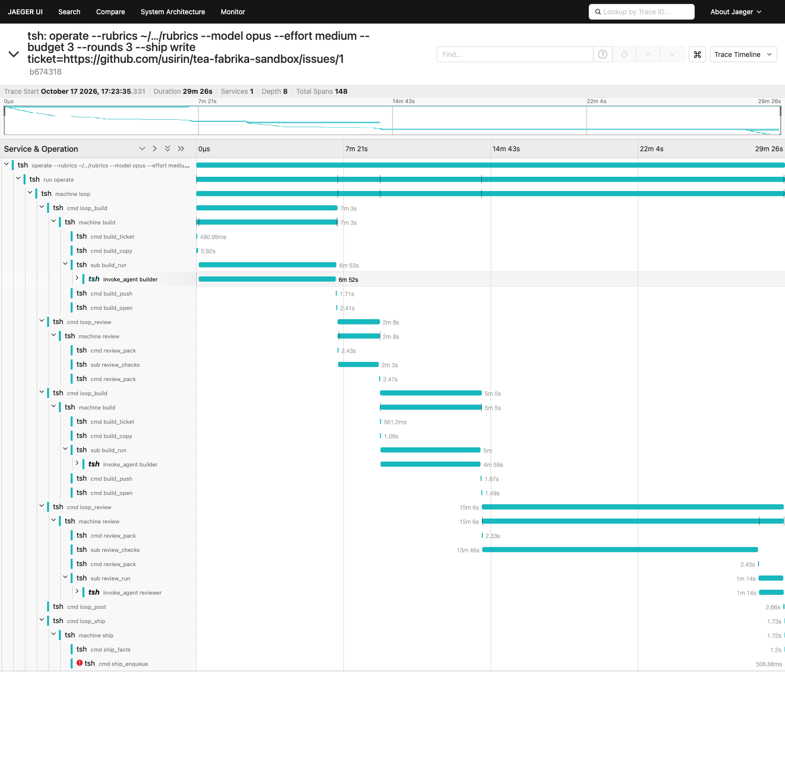

# 69. The build loop: build, review, build, review, ship

```sh
# Docker Desktop running first
pnpm trace:up
# TSH_WORK lists build and operate. They write to kamp-us/tea-fabrika-sandbox and nowhere else.
# (The runs below were made when the sandbox was usirin/tea-fabrika-sandbox. It has since
# moved to kamp-us and gone public, so it can have a merge queue; the old links forward.)
TSH_WORK=~/.tsh/work TSH_OWN=<your login> TSH_TRACE=1 bin/tsh -c \
  'operate --rubrics <rubric folder> --model opus --effort medium --budget 3 --rounds 3 --ship write ticket=https://github.com/kamp-us/tea-fabrika-sandbox/issues/1'
open http://localhost:16686
```



## What we asked

Can one tsh line take a real ticket through build, review, build again on
what the review left open, and ship? The stages stay machines, used as
libraries. `operate` is a small program that wires them. And it can write to
one private sandbox repository only, by structure, not by a rule someone has
to remember.

The open question: when should the loop stop? We tried this rule. Stop when
nothing is open. Stop when a round leaves the open list no smaller than the
round before. Stop at a cap on rounds.

## What was built

| Piece | Where | What |
|---|---|---|
| The sandbox | `src/sandbox.ts` | The one repository anything here writes to. `SandboxTicket` and `SandboxPullRequest` are string schemas that take a url in the sandbox and nothing else. `sandboxOnly(url)` dies on any other url. |
| The build machine | `src/stages/build/machine.ts` | `reading` the ticket, `copying` a working copy, `building` (the builder's run, a Listen), `pushing`, `opening` the pull request, `over`. Every write is an Act with an intent, so a restart sends the same write again and finds its own first one. |
| The build gate | `src/stages/build/ticket.ts` | Pure: a closed ticket, a merged pull request from the branch, a missing `ready-for:agent` label, or no criteria stops it. A ticket that goes hands on its criteria as a non-empty list, so nothing after the gate asks again. |
| The builder | `src/stages/build/builder.ts` | The Claude Agent SDK, like the reviewer: opus, a budget per run, traced with `sdkTrace`. It works in the working copy and only there. Its form is `{summary, deviations, ran, left}`. It never commits or pushes. |
| The build's writes | `src/stages/build/github.ts` | git and gh on Effect's `ChildProcess`, through `src/child.ts`. One clone of the sandbox under `TSH_WORK`, one worktree per ticket on branch `build/<n>`. Push is never forced. Open reads first: an open pull request from the branch gets its text changed, so a second send opens no second one. |
| The build program | `src/stages/build/program.ts` | `build`: flags `model`, `effort`, `budget`; input `ticket` (a sandbox ticket); outputs `built` and `opened`. `buildToTheEnd` runs one build machine to its end under an id, and is what operate uses. |
| The loop machine | `src/stages/operate/machine.ts` | `building`, `reviewing`, `posting`, `shipping`, `over`. Each stage is one Act, whose intent names the ticket, the round and the stage. It never reads a stage's state. |
| The stop rule | `src/stages/operate/stop.ts` | Pure functions: `openItems`, `afterBuild`, `afterReview`, `afterShip`. The rule is the table below. |
| The loop's writes | `src/stages/operate/writes.ts` | `ReviewWrites.post` puts a review's verdict on the pull request as a comment, in fabrika's marker format (`review-code: PASS @ <head> — <reason>`), so the ship stage reads it the way it reads any reviewer's. Read before written. `sandboxWritesOn` holds ship's enqueue and re-run to the sandbox. |
| The operate program | `src/stages/operate/program.ts` | `operate`: flags `rubrics`, `model`, `effort`, `budget`, `rounds` (1 to 5), `ship` (`read` or `write`); input `ticket` (a sandbox ticket); outputs `step` (each stage of each round) and `ended` (how the loop ended, and every round). Machines: `loop`, `build`, `review`, `ship`. |
| tsh | `src/tsh/fabrika.ts`, `src/tsh/launch.ts` | `TSH_WORK` lists `build` and `operate`. Without it, tsh writes nowhere, as before. |
| The review reader | `src/code-host-github.ts` | `checks: "every"`: the sandbox requires no check, so its reader waits on every check, not only the required ones. |

The stop rule, after each review:

| What the review left | What the loop does |
|---|---|
| nothing open | ship |
| open, no fewer than the round before | stop: `ask:owner:no_progress` |
| open, and this was the last round | stop: `ask:owner:rounds` |
| open, fewer than before | build again, told what is open |

"Open" counts each criterion the review left open, plus one for red checks.
A first round has no round before it, so it never stops on no progress. A
later build that changed nothing stops before its review
(`ask:owner:no_change`): the same commit would get the same answer. A ship
that sends the pull request back to the builder is one more round under the
cap.

What the next round is told is each open criterion with the reviewer's
words, the lines it points at, and what each finding wants. Red checks are
one item with no criterion number.

## The write lock: two holds

The owner allowed writes to `usirin/tea-fabrika-sandbox` only. Every write
is held to it twice.

1. **By shape.** `build` and `operate` take a ticket only as
   `https://github.com/usirin/tea-fabrika-sandbox/issues/<n>`. Any other url
   does not fit the input's schema. tsh refuses the line before anything
   starts, with status 2, like `ship --mode write`. A program started from
   code refuses it with `bad_shape`, and nothing is read.
2. **At the write.** Each write side checks its target first and dies on any
   other: the build's copy, push and open, the verdict comment, ship's
   enqueue and re-run. The git remote, the comment path and the pull request
   path are the sandbox constant. None is read from a url.

The check is a whole-url match, not "starts with". A first version used
"starts with". `prOf`, which ship's writes use to find a pull request's
repository, takes the last `github.com/<o>/<r>/pull/<n>` in a string. So
`<sandbox>/pull/1?https://github.com/kamp-us/demlik/pull/1` passed the hold
and named demlik. Tests now cover five look-alikes like that.

## Proofs

### 1. One tsh line, a real ticket: build, review, a rebuild, ship

Sandbox ticket 1, a copy of demlik #670 (`stop()` hangs when the store's
final save hangs; 9 criteria). One line, `--ship write`, `--rounds 3`.

| Round | Stage | Outcome | Time | Cost |
|---|---|---|---|---|
| 1 | build | done: opened [pull 4](https://github.com/usirin/tea-fabrika-sandbox/pull/4), 10 files | 7m 3s | $1.19 |
| 1 | review | `send:builder:checks_red` | 2m 8s | $0 (no reviewer: CI red) |
| 2 | build | done: one line changed | 5m 5s | $0.33 |
| 2 | review | `done`, 9 of 9 criteria met | 15m 6s | $0.48 |
| 2 | post | `review-code: PASS` and `review-doc: PASS` at the head | 3s | |
| 2 | ship | `stuck:enqueue_failed` | 2s | |

`ended stuck:ship, said stuck:enqueue_failed, rounds 2`. About $2.00 and 29
minutes.

The rebuild was real. Round 1 added a new published name to `@demlik/tea`'s
stable entry with a `patch` changeset. The sandbox's CI runs demlik's API
ratchet, which asks for a `minor` there, and went red. The review sent it
back without starting a reviewer. Round 2's builder was told only "a check is
red at the head". It ran the CI gates itself, found the ratchet, and changed
the changeset to `minor`. CI went green, and the reviewer passed all 9
criteria.

Ship refused with a reason. The sandbox has no merge queue, and ship never
merges directly, so its enqueue fails: `stuck:enqueue_failed`. This is the
designed answer, not a bug.

The trace is one tree of 148 spans: the line, `run operate`, `machine loop`,
then per round `cmd loop_build > machine build > cmd build_ticket, build_copy,
sub build_run > invoke_agent builder > chat, execute_tool, cmd build_push,
build_open`, and the same for review and ship. The screenshot is that trace.
The rubric folder's path in the root span's name is shortened in the image.

### 2. The stop rule

Proved in tests, on the real loop, build, review and ship machines, with a
scripted builder and reviewer (`src/stages/operate/program.test.ts`,
`src/stages/operate/stop.test.ts`):

- A reviewer that fails criterion 4 every time: round 1 leaves 1 open, round
  2 leaves 1 open. The loop ends `ask:owner:no_progress`, says
  `send:builder:review_failed`, and nothing is enqueued.
- With `--rounds 1`, the same review ends `ask:owner:rounds` after one round.
- A failing then passing reviewer: round 2's builder is told criterion 4 and
  the finding's "wants", the review passes, the verdicts are posted, ship
  lands it. Three runs, one answer.
- Pure cases: no progress at 2 then 2 and 2 then 3; a first round never stops
  on no progress; a later build that changed nothing ends `no_change`; a
  ship send-back is one more round under the cap and none at it.

Live, no run hit the no-progress stop. Both live tickets that went to a
second round were fixed in it.

### 3. A demlik target is refused at decode, and nothing was written there

- `src/tsh/check.test.ts`: `operate … ticket=https://github.com/kamp-us/demlik/issues/670`
  and the same for `build` are refused before anything starts: "not a ticket
  in the sandbox", status 2. So is `…/tea-fabrika-sandbox-x/issues/1`.
- `src/stages/operate/program.test.ts` and `src/stages/build/program.test.ts`:
  told a demlik issue, a demlik pull request, a look-alike repo or a sandbox
  url with demlik's after it, the running program answers `bad_shape`, and
  no read or write happens.
- `src/sandbox.test.ts`: every write side dies on demlik and on five
  look-alike urls before `gh` is called.
- Checked with `gh` after the runs: demlik has no `build/<number>` branch
  (the names this loop pushes), no pull request from one, and no comment
  since the runs began that holds this loop's words ("criteria met", "tea-
  fabrika build loop"). The `build/<n>-<slug>-<hash>` branches there, and
  demlik's newest pull request, come from fabrika's own build of #690, which
  ran at the same time. They are not this loop's.

### 4. kill -9 mid loop, then reattach

Sandbox ticket 2, a copy of demlik #558 (replay asks for a ctx a machine
does not have). Started as a job, `operate … & close %1 ticket; attach %1`.

| Step | What happened |
|---|---|
| Round 1 | build opened [pull 5](https://github.com/usirin/tea-fabrika-sandbox/pull/5) ($0.60); review `send:builder:checks_red` |
| kill -9 | the tsh process, about one minute into round 2's build |
| After | the builder (the Agent SDK's process) kept running, re-parented to init. I stopped it by hand. The working copy was clean. |
| `tsh -c 'jobs; attach %1'` | `[1] detached operate …`; the run went on at round 2's build, not round 1 |
| Round 2 | build ($0.38) changed the changeset to `minor`; review `done`, 7 of 7 ($0.36); verdicts posted at the head |
| Ship | `stuck:enqueue_failed` (no merge queue); the loop ended `stuck:ship`, rounds 2 |

No duplicate. The sandbox has two pull requests in all, 4 and 5. Branch
`build/2` has exactly two commits, one per round. There was one round 1
review and one round 2 review.

On reattach the trace shows two builder runs for round 2, 12 ms apart. The
first is the Listen opening again when the kept machine loaded. `resume`
then counts one more run, so the Listen is replaced. The first one was cut
off before its first turn and cost nothing.

The trace holds both lives: the first line's root and the `jobs; attach %1`
root. The spans that were still open at the kill were never sent, so some
of the first life's spans show as children of a parent that is missing.

## Findings

1. **The review's red-check item is enough for a builder that can run the
   gates.** "A check is red at the head" names no check. Round 2's builder
   found the API ratchet by running the CI gates in its sandbox. It cost
   $0.33. This held twice, on tickets 1 and 2.
2. **kill -9 leaves the builder running.** The Agent SDK's process is a child
   of tsh, and a `kill -9` does not reach it. It was re-parented to init and
   kept running in the working copy, on the owner's account. The reattached
   run started its own builder in the same copy. I stopped the orphan by hand.
   Two builders in one working copy can write over each other.
3. **A job told a value on its line keeps that input open.** `operate …
   ticket=X & attach %1`: after the loop ended, the run waited for more
   tickets. Nothing kept Node's event loop alive, so Node exited with code 13
   ("unsettled top-level await"), and the spans not yet sent were lost. The
   same happens with `tally add=2 & attach %1`. `close %1 ticket` after the
   start avoids it.
4. **A build that changes nothing said nothing about why.** Ticket 3 (demlik
   #555) ended `stuck:no_change` after $2.63. Its builder used Edit and Write,
   and the copy was clean at the end. Its form was in the build machine's
   report, and the loop dropped it. `step` now carries `says`: the builder's
   summary, what it left, and any problem; for a review, each open criterion.
5. **A Listen moves a loaded machine before its starter can send resume.**
   The builder's run is a Listen. When a kept build machine is loaded in
   `building`, its Listen opens again at once. A fast builder can finish and
   move the machine to `pushing` before the starter reads the state. The
   starter then saw `pushing` and sent `resume`, which sent the push again.
   The test caught it. The fix: read the kept state before the machine
   starts, and send `resume` only if the machine still stands where it was
   kept. operate does the same for review and ship. The review and ship
   programs still read the state after start.
6. **The handle's `changes` lags while an Act's handler runs.** A test that
   waited on `loop.changes` for `reviewing` in round 2 never saw it while
   the review stage ran inside the loop's Act. Tests now wait on the
   reviewer's own start.
7. **The builder's sandbox blocks local ports.** demlik's `node.test.ts`
   opens one, so it fails inside the SDK sandbox. The builder said so in its
   form and in its commit. CI ran it.
8. **The ticket's builder wrote good PR text.** The body closes the ticket,
   lists deviations, the checks it ran, and what it left. The reviewer read
   "Deviations: None." as the builder's word, as it does for fabrika's
   builders.

## Recommendations

1. **Keep the stop rule as built** (75%). It ended every case in the tests
   the way an owner would, and no live run needed it. The doubt: no live run
   stalled, so the "no smaller" test has only met scripted reviewers. What
   would raise it: a ticket the builder cannot finish, run live with
   `--rounds 3`.
2. **Kill the builder's process group when its run is cut off** (85%). Start
   the SDK in its own process group and make `liveBuilder`'s scope kill it.
   A `kill -9` of tsh still leaves it. So also take a lock on the working
   copy, held by the process, and have a resumed build wait for it. Owner:
   tea-program and the build stage.
3. **Close a value-fed input when its line is done** (80%). A job told
   `ticket=X` on its line should see that input closed, like a foreground
   call does. Owner: tsh.
4. **Name the red check in the item** (70%). The builder found it, but it
   paid to look. The review already reads every check with its state. The
   item could list the red ones by name.
5. **Read the kept state before start in every starter** (85%). Make it the
   one way: a helper that loads, starts, then sends start or resume. Review
   and ship's own programs would get the fix from finding 5. Owner:
   tea-program.
6. **Add a merge queue to the sandbox, or a merge path for the sandbox
   alone** (60%). Without one, ship can never land anything there, so the
   `done` path is proved only in tests.

## Holes

Each security hole names its owning layer.

1. **The builder's account.** The builder runs on the owner's Claude login.
   Its environment has no GitHub token (`agentEnv`), its sandbox has no
   network, it cannot read the login files under the home folder, and a
   command that names gh, git push, curl and the like is refused by name.
   But the SDK sandbox's network block is the main wall. A command that
   reaches the network another way, on a machine where the sandbox is off,
   would carry the owner's Claude login. Layer: user config (the SDK sandbox
   must be on; `failIfUnavailable` is set, so it fails closed).
2. **The orphaned builder** (finding 2) runs with the same limits, but
   unwatched. Layer: tea-program.
3. **Code's own git and gh carry the owner's GitHub token.** They run with
   `hostEnv`: the run variables, `GH_TOKEN`/`GITHUB_TOKEN`, `GH_CONFIG_DIR`,
   `SSH_AUTH_SOCK`. The token can write to every repository the owner can.
   The holds above are what keep it on the sandbox. A fine-grained token for
   the sandbox alone would make it so at GitHub too. Layer: user config.
4. **git hooks.** The working copy is the sandbox's code. Its hooks would run
   on commit and push. Code's git runs with `core.hooksPath=/dev/null` and
   `--no-verify`. Layer: the build stage.
5. **The worktree's `pnpm install`** runs the sandbox's lockfile, with its
   install scripts, under `runEnv` (no tokens). Layer: the build stage.
6. **Verdicts are posted as the owner.** Ship counts verdicts by the accounts
   in `TSH_REVIEWERS`. Anyone who can comment on a sandbox pull request as
   that account can pass it. Layer: fabrika (the marker format trusts the
   account).
7. **The comment check is the first 100 comments.** A pull request with more
   could get a verdict posted twice. Layer: the build loop's writes.
8. **Ship's merge path is untested live** (rec 6).
9. **The fence's one-write window** from 68a still holds across processes.
   Layer: tea-program.

## Not done

- No live run hit the no-progress stop or the round cap.
- No live merge: the sandbox has no merge queue. Making a ruleset and turning
  off the sandbox's publish workflow were refused by this session's
  permissions; the owner can do both.
- The review and ship programs' own starters still read state after start
  (finding 5).
- `build`'s program does not take on kept builds on its own at start, as
  operate does. A killed `build` job is taken on when it is told the same
  ticket again.

## New names

`SANDBOX`, `SANDBOX_URL`, `SandboxTicket`, `SandboxPullRequest`, `inSandbox`,
`sandboxOnly`, `numberOf`; `runChild`, `runLow`, `Exited`; `hostEnv`;
`Counted`, `checks: "every"`; the build stage's `BuildHost`, `BuildWrites`,
`Builder`, `BuildBrief`, `Built`, `BuildDrafted`, `BuildAsk`, `BuildReport`,
`buildGate`, `Ticket`, `Opened`, `Item`, `READY`, `branchOf`, `briefOf`,
`messageOf`, `bodyOf`, `buildToTheEnd`, `buildProgram`, `gitHubBuild`,
`liveBuilder`, `builderRefusal`, `scriptedBuilder`; the loop's `loop`,
`LoopSettings`, `LoopOutcome`, `Round`, `Next`, `BuildEnd`, `ShipEnd`,
`openItems`, `afterBuild`, `afterReview`, `afterShip`, `Post`, `postsOf`,
`ReviewWrites`, `Verdict`, `markerOf`, `commentOf`, `reviewWritesOn`,
`sandboxWritesOn`, `gitHubSandboxWrites`, `operateProgram`, `Step`, `Ended`;
tsh's `TSH_WORK` and `sandboxEntries`. Outcome words: build's
`copy_failed`, `draft_failed`, `no_change`, `push_failed`, `open_failed`;
the loop's `ask:owner:rounds|no_progress|no_change|ship` and
`stuck:build|review|post|ship`.

## Node edges

- `src/stages/build/builder.ts`: `node:fs` `realpathSync`, `node:os`
  `tmpdir`/`homedir`, `node:path`. The SDK's options take plain strings, made
  once when a run starts.
- `src/tsh/fabrika.ts`: `node:path` `join`, for the reviewer's clone path.
- `src/env.ts`: `process.env`, as before.
- `src/stages/build/github.ts`, `src/stages/operate/writes.ts`:
  `@effect/platform-node`'s `NodeServices` layer gives Effect's
  `ChildProcessSpawner`, `FileSystem` and `Path`. Everything else there is
  Effect.

`@demlik/tea` is unchanged.
