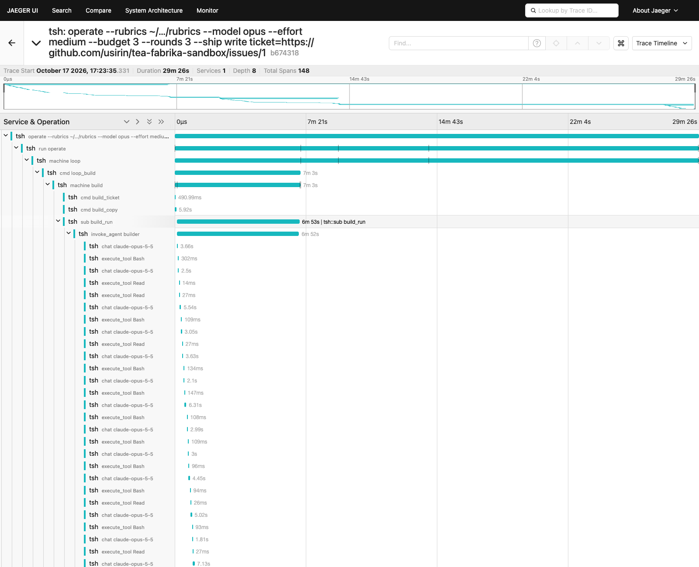
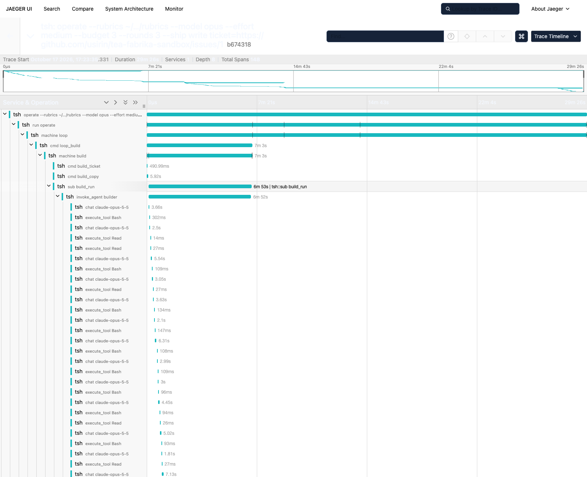
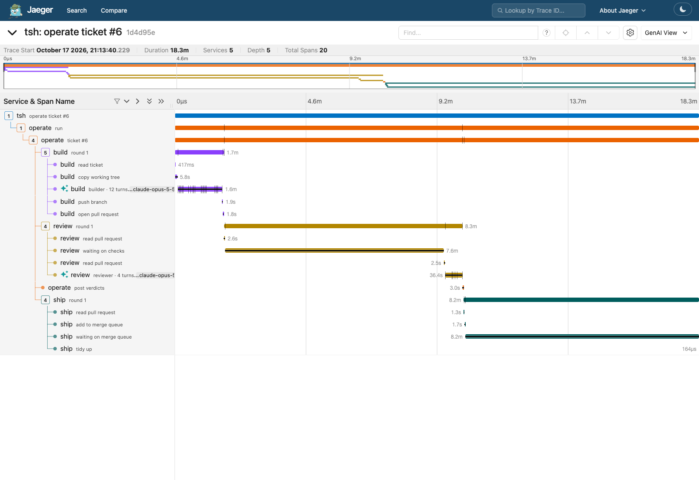
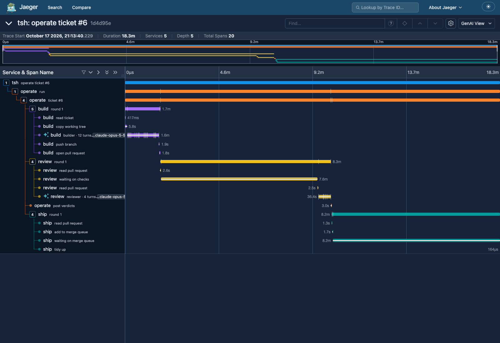
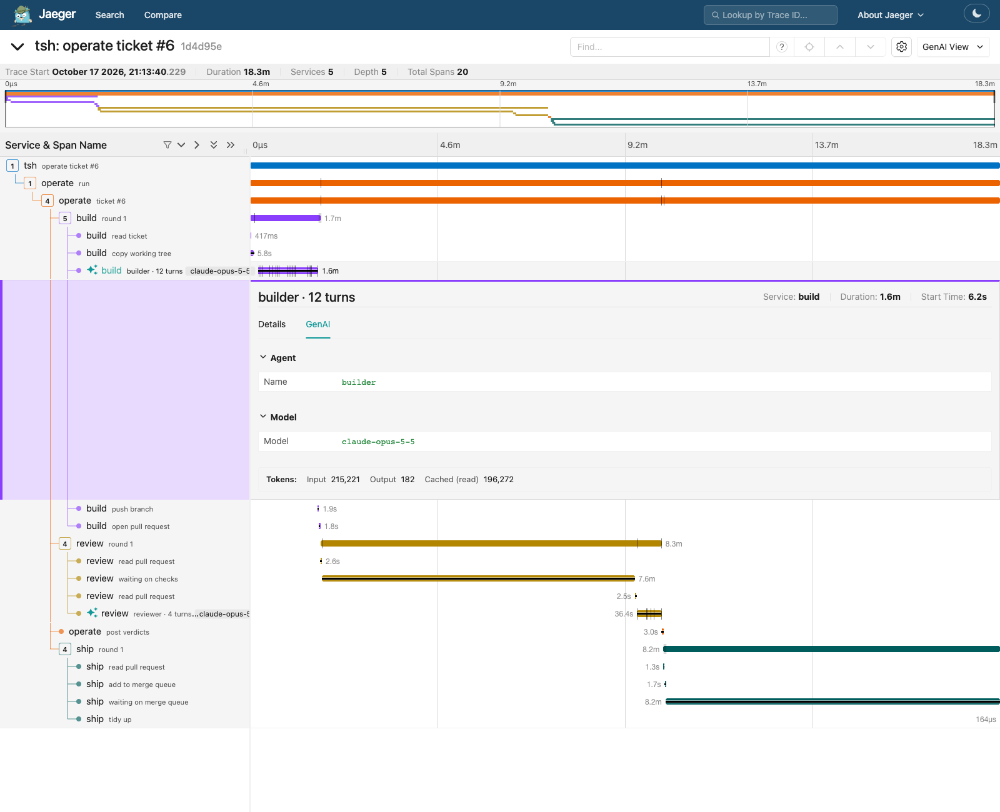
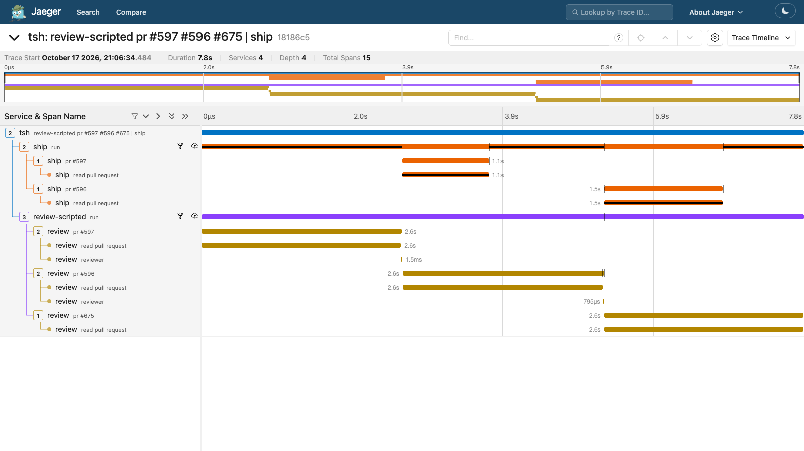
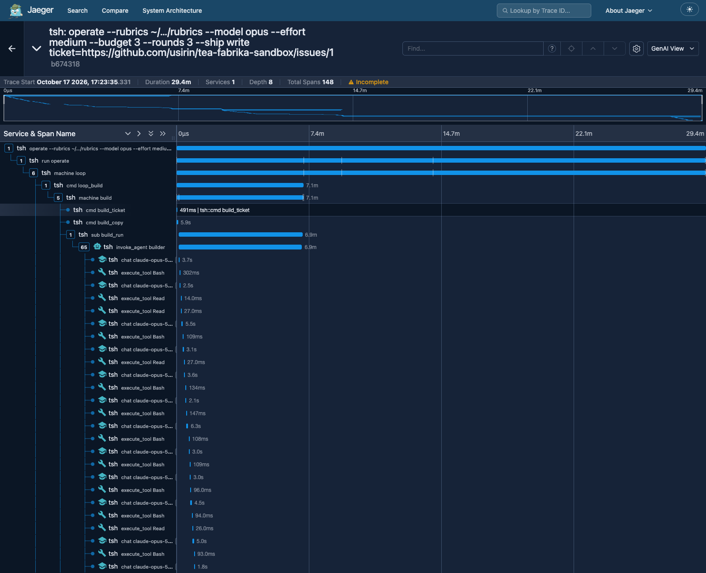

# 70. Readable traces: a tsh line a person can read in Jaeger

```sh
pnpm trace:up        # Jaeger 2.21.0, traces kept in the Docker volume tsh-jaeger-data for 90 days
TSH_TRACE=1 bin/tsh -c 'review-scripted --rubrics <rubric folder> pr=<pr> pr=<pr> | ship --mode read'
pnpm vitest run src/tsh/trace.test.ts src/trace/view.test.ts src/trace/agent.test.ts
```

## The ask

A real 29-minute `operate` trace from experiment 69 was hard to read:

- Every span was service `tsh`, so every row had the same color.
- The root was named by the whole typed line, an absolute rubric path in it.
- 112 of its 148 rows were `chat <model>` and `execute_tool <tool>`. The
  stages were lost between them.
- Jaeger flagged the trace: "invalid parent span IDs", shown as
  "Incomplete" in Jaeger 2.
- The page was half dark.

The goal: the shape of a run at a glance. Which stages ran, in which round,
how each ended, and where it went wrong. The agent detail stays one click
away.

## Before

Jaeger 1.76, light and dark. The same trace, the absolute path cut to `~/…`
for this page.





## After

A live `operate` on sandbox ticket 6, a copy of a small open tea docs
ticket. One round: build, review, ship through the merge queue. Merged
after 18 minutes, for $0.50.

```sh
TSH_WORK=<folder> TSH_OWN=<your login> TSH_TRACE=1 bin/tsh -c \
  'operate --rubrics <rubric folder> --model opus --effort medium --budget 3 --rounds 3 --ship write ticket=https://github.com/kamp-us/tea-fabrika-sandbox/issues/6'
```

20 spans, 5 services. The longer run in the before pictures had 148 spans,
115 of them agent spans, and one service.





The builder's row opened. Jaeger's GenAI tab reads the folded span: the
agent, the model, the tokens.



The tags on the stage spans, from the exported trace:

```
operate  ticket #6  tea.outcome=done tea.round=1 tea.cost.usd=0.5041 tea.pr=…/pull/8 tea.ticket=…/issues/6
build    round 1    tea.outcome=done tea.head=a87f67e tea.cost.usd=0.2948 tea.pr=…/pull/8
review   round 1    tea.outcome=done tea.head=a87f67e tea.cost.usd=0.2093 tea.pr=…/pull/8
ship     round 1    tea.outcome=done tea.head=a87f67e tea.pr=…/pull/8
builder · 12 turns  tea.agent.tools="Bash 9, Read 3, Edit 2, Grep 1, StructuredOutput 1"
```

Nothing went red in this run. The red case is pinned by the tests: a ship
stuck on checks is red with `stuck:checks_stuck` as its message
(`src/tsh/trace.test.ts`), and `src/trace/view.test.ts` covers `ask:*`,
`send:builder:*` and a failed agent.

The read-only line on three demlik pull requests,
`review-scripted pr=… pr=… pr=… | ship --mode read`:



## What changed

### One color per stage

Each span says which program or stage it belongs to, in `service.name`.
Jaeger colors and lists spans by service, so each stage is now its own color
and its own row in the service list. It is still one trace per tsh line.

| Span | Service |
|---|---|
| The line's root | `tsh` |
| A program's run | the program: `operate`, `review-scripted`, `ship` |
| A stage machine and its steps | the stage: `build`, `review`, `ship` |
| The operate loop | `operate`, from its run |

OpenTelemetry keeps `service.name` on the resource, which is one per tracer
provider, not one per span. Two ways to get there:

- One provider per service. Every span would need to know its provider
  before it starts, and Effect's tracer is one Layer for the whole process.
  Dropped.
- Write `service.name` as a span attribute, the way any other tag is
  written, and move it to the resource on the way out. Kept.

The move happens in the exporter's view (`src/trace/view.ts`). It keeps one
resource per service, because OTLP groups spans by resource and a new object
per span would split them. Effect code never touches OpenTelemetry for it.

A span says its service explicitly. A machine's span takes its `Drawing`'s
service or, when it has none, the service its fiber is annotated with
(`Effect.annotateSpans`, set by the program's run). The operate loop has no
service of its own and so shows as `operate`.

### Names a person reads

Each machine run now comes with a `Drawing`: its span's name, its service,
a plain name for each Cmd and Sub, and the tags it puts on its span.

```ts
export const reviewDrawing = (name: string, pr: string): DrawingOf<typeof review> => ({
  name,
  service: "review",
  steps: {
    review_pack: "read pull request",
    review_checks: "waiting on checks",
    review_run: "reviewer",
    review_file_note: "keep note",
  },
  attributes: prAttributes(pr),
});
```

`steps` must name every Cmd and Sub type the machine has, or say `null`. A
new Cmd that is not in the drawing does not compile. `null` means no span:
the operate loop's `loop_build` is `null`, because the build machine's own
span (`round 1`) is the span that matters there.

The names:

| Before | After |
|---|---|
| `operate --rubrics /…/rubrics --model opus … ticket=https://…/issues/1` | `operate ticket #1` |
| `run operate` | `run`, in service `operate` |
| `machine loop` | `ticket #1` |
| `machine build` | `round 1`, in service `build` |
| `cmd build_ticket`, `sub build_run` | `read ticket`, `builder` |
| `machine review` | `round 1` or `pr #597`, in service `review` |
| `cmd ship_enqueue` | `add to merge queue` |

The root's name is the program and each told input as `#n`, stages joined by
` | ` (`src/tsh/title.ts`). The whole typed line stays on the root as
`tsh.line`. It is the one attribute where a value may be. A test pins that
the rubric path and `--budget` appear on no other span.

Names do not repeat the stage or round from above them. The service column
says `review`, and the parent says `round 2`, so the step is just
`waiting on checks`.

### Outcomes at a glance

A stage span is red when its outcome says it went wrong:

- `stuck:*`, for example `stuck:checks_stuck`;
- `ask:*`, for example `ask:owner:budget`;
- `send:builder:*`, a red CI round sent back to the builder.

`done`, `skip:*` and every other `send:*` stay green. The status message is
the outcome itself, so Jaeger's error tooltip says what happened.

Effect sets a span's status itself when the span ends: an Effect that
succeeds is OK. A stage that ends `stuck` still succeeds, as an Effect. So
the status is set in the exporter's view, from the `tea.outcome` tag
(`wentWrong` in `src/stages/outcome.ts`). The other way was to fail the
Effect to get the red, which would change how a program ends to change how a
trace looks. Dropped.

Stage spans carry these tags, as each becomes known:

| Tag | What |
|---|---|
| `tea.ticket` | the ticket's url |
| `tea.round` | the build round |
| `tea.pr` | the pull request's url |
| `tea.head` | the head commit, 7 characters |
| `tea.outcome` | how the stage ended |
| `tea.cost.usd` | what its agent cost; on the loop, summed over rounds |

`jaeger/ui.json` turns `tea.pr` and `tea.ticket` into links in the span
detail.

### Agent detail without the noise

tea's `agentSpans` makes one `invoke_agent <name>` span per agent run, with a
`chat <model>` span per turn and an `execute_tool <tool>` span per tool call
under it. That is the shape Langfuse reads, so tea keeps it. The fold below
is in tsh's exporter only. An exporter plugged in without the view gets the
spans as tea made them (`memoryTracing({raw: true})` is the one the tests
use).

For Jaeger, the view folds them into the span that started the agent:

- The span's name gains a count: `builder · 23 turns`.
- Its tags gain the agent, the model, the token sums, the turn and run
  counts, and the tools used: `tea.agent.tools = "Bash 15, Read 8"`.
- Each turn and each tool call becomes an event on it, in order, with its
  duration and tokens.
- An agent run that failed turns the span red.

So the live run's 12-turn builder, with 16 tool calls, is one row, not 29.

Other options tried:

- A span per turn, with tools under it. Still dozens of rows. Dropped.
- The agent in a trace of its own, linked. Jaeger shows links poorly, and the
  run's time would be split. Dropped.

tea is not edited. Its `agentSpans` has no way to take a parent span in the
installed version (`@demlik/tea` 0.20.0). demlik has since merged a `parent`
option (kamp-us/demlik pull 691), but no release carries it yet. So the
wrapper in `src/trace/agent.ts` that gives the agent's spans their parent
stays as it was.

### The "invalid parent span IDs" warning

Each run's spans hang off a made-up parent, so the same run key gives the
same trace id in any process (experiment 68). A run killed and attached
again writes into the trace it wrote into before. Nothing was ever exported
under that parent, so Jaeger saw spans whose parent did not exist.

The made-up parent's span id is now derived from the run key
(`traceParentIdOf`). The view drops a parent with exactly that id on export.
The trace id is untouched, so kill and attach still writes into the same
trace. A test pins both: the roots have no parent, and both share one trace
id. Real parents are kept.

### The viewer: Jaeger 2.21.0

The half-dark page is a Jaeger UI bug in 1.76:
jaegertracing/jaeger-ui issue 3203. Its dark theme follows the system's
`prefers-color-scheme` and colors only part of the page. Seen in a headless
Chromium with dark mode emulated.

Jaeger 2.21.0 has a full light and a full dark theme, with a toggle. Its
trace page also has a GenAI tab. It reads the folded agent span (agent,
model, tokens), since the fold keeps those tags. `trace:up`
now runs `jaegertracing/jaeger:2.21.0` with `jaeger/config.yaml`:

- Badger on the same volume, `tsh-jaeger-data`, the same `/badger/key` and
  `/badger/data`, 90 days.
- The traces Jaeger 1.76 stored there still load in 2.21.0. The volume was
  not wiped.
- OTLP over HTTP on 4318, the UI on 16686, as before.

2.22.0 is newer, from 11 days before this run. 2.21.0 was the one tested
here; it is pinned exactly.

Jaeger 2 sends traces of its own requests into its own store, under the
service `jaeger`. `service.telemetry.traces.level: none` in the config does
not stop it on 2.21.0. The environment variable
`OTEL_TRACES_SAMPLER=always_off` does, and `trace:up` sets it.



## Findings

1. **Most of the mess was the program's, not the viewer's.** One service,
   machine-type names and the full line as the root all came from what the
   program wrote. A drawing per machine fixed them, in about 140 lines.
2. **Status belongs to the outcome, not the Effect.** A stage that ends
   `stuck` is a program that worked. Red in a trace is a reading of the
   outcome, so the exporter's view sets it.
3. **One provider is enough for many services.** An attribute moved to the
   resource on export gives each stage its own color, with one Effect tracer
   Layer.
4. **The raw agent spans are worth keeping.** Folding them in the view, not
   in tea or the program, leaves Langfuse's shape whole.
5. **Jaeger 2's own telemetry setting does not stop self-tracing.** An
   environment variable does.
6. **The folded sums showed a counting bug the raw rows hid.** A 12-turn
   builder that edited files has 182 output tokens in all, 3 to 40 a turn.
   Spread over 12 rows, each small number looked fine. Summed on one row, it
   is plainly wrong. The cost tag comes from the stage's spend, not from
   these counts.

## Recommendations

1. **Keep the drawing required on every `keep.run`.** 90%. A machine started
   without a name and steps would bring back `cmd build_ticket` rows.
   The cost is one object per machine, typed against its Cmds and Subs.
2. **Move `trace:up` to Jaeger 2.21.0.** 90%. The half-dark page is gone,
   and old traces still load. The cost is a config file instead of
   environment variables.
3. **Drop the agent wrapper when tea publishes the `parent` option.** 85%.
   One less place that knows OpenTelemetry. Waits on a tea release.
4. **Give `send:*` an explicit "went wrong" list in the outcome grammar.**
   70%. Today `wentWrong` knows that `send:builder` is a red round. A new
   `send` that also means trouble would stay green until someone adds it.
   What would lift this: a second stage that sends back for a fix.

## Holes

| Hole | Layer |
|---|---|
| A failed Effect's stacktrace event carries absolute file paths. | tea-program, from Effect |
| Agent spans are held until the span that started them ends. A long tsh session with a long agent run holds them in memory. | tsh |
| tea 0.20.0 has no `parent` option for `agentSpans`; the wrapper stays. | tea |
| The service list still shows `jaeger` and `jaeger-all-in-one`, from self-traces stored before the fix, until the 90 days run out. | user config |
| `ship --mode read` that stops before an outcome stays green. | tsh |
| Urls and `#n` are in tags and names. They are ids, not values, but a private repo's would show. | tsh |
| A trace killed and attached shows two roots, one per process. | tsh |
| Jaeger's GenAI tab gets folded agent spans, not each chat and tool span. A raw switch for `TSH_TRACE` would bring them back. | tsh |
| Output tokens per turn are 3 to 40 on every turn, so the sums are far too low (182 for a 12-turn builder). They look like the count at the start of each streamed message. | tea |

## New names

- `Drawing` (`src/program/trace.ts`): how one machine run is drawn in a
  trace: its name, its service, a name per step, its tags.
- `DrawingOf<typeof machine>` (`src/stages/traced.ts`): a drawing typed by a
  machine.
- `buildDrawing`, `reviewDrawing`, `shipDrawing`, `loopDrawing`
  (`src/stages/traced.ts`).
- `view` (`src/trace/view.ts`): the exporter's view of a trace.
- `wentWrong` (`src/stages/outcome.ts`).
- `titleOf`, `attachTitleOf` (`src/tsh/title.ts`).
- `traceParentIdOf`, `SERVICE_NAME` (`src/program/trace.ts`).
- Attributes `tsh.line`, `tea.ticket`, `tea.round`, `tea.pr`, `tea.head`,
  `tea.outcome`, `tea.cost.usd`, `tea.agent.runs`, `tea.agent.turns`,
  `tea.agent.tools`.

## Node edges

None new. `src/trace/view.ts` is OpenTelemetry's SDK, as `src/trace/otel.ts`
already was. `jaeger/` is Docker's.

`@demlik/tea` is unchanged.
