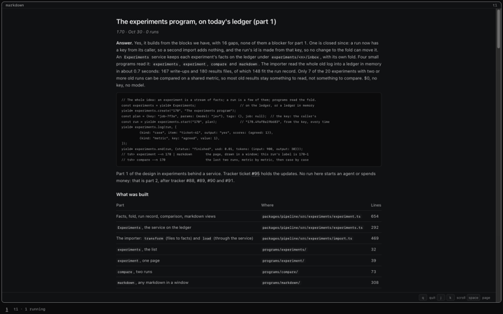

# experiment: `@tea-fabrika/experiment`

One experiment: its page as data (the write-up and its runs), then the same page as markdown,
a view drawn from the data, and it ends. It reads through the `Experiments` service
([`packages/pipeline/src/experiments/`](../../packages/pipeline/src/experiments/experiments.ts))
and writes nothing. The fabrika app lists it.

```ts
import {call} from "@kampus/fabrika";
import {experiment} from "@tea-fabrika/experiment";

yield* call(experiment, {n: "170"});
// {kind: "called", heard: [
//   {name: "page", value: {n: "170", title: "The experiments program", writeUp: {...}, runs: [...]}},
//   {name: "markdown", value: "# The experiments program\n\n_170 · Oct 30 · 1 run_\n\n**Answer.** ..."}]}

yield* call(experiment, {n: "404"});
// ended: failed, ExperimentsFailed {why: "no_experiment"}
```

```text
tsh> experiment --n 170 | markdown        the page, drawn in a window
tsh> experiment --n 404 | markdown        tsh: experiment failed: no experiment 404 on the ledger
```



## What's in it

| Import | File | What it gives |
|---|---|---|
| `@tea-fabrika/experiment` | `src/index.ts` | `experiment`, the program: flag `n`, outputs `page` and `markdown`. It needs `Experiments`. |

- The markdown is made from the data each time (`ExperimentPage.toMarkdown`): the answer first,
  then the sections, then a table of runs. It is never kept.
- No machine and no window, for the same reason as `experiments`.
