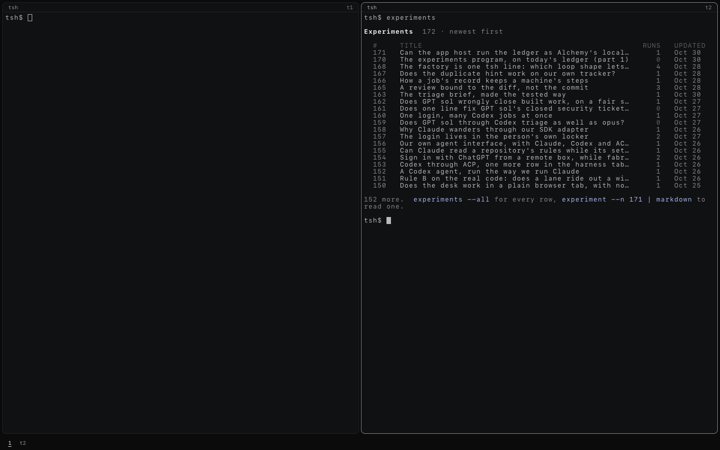

# experiments: `@tea-fabrika/experiments`

Every experiment on the ledger, newest first, as `gh pr list` lists pull requests: one row each,
then the list as markdown, and it ends. It reads through the `Experiments` service
([`packages/pipeline/src/experiments/`](../../packages/pipeline/src/experiments/experiments.ts))
and writes nothing. The fabrika app lists it.

```ts
import {call} from "@kampus/fabrika";
import {experiments} from "@tea-fabrika/experiments";

yield* call(experiments, {});
// {kind: "called", heard: [
//   {name: "row", value: {n: "170", title: "The experiments program", date: "2026-10-30", runs: 1,
//     latest: {run: "170.ed1e1dcf9719", label: "170-1", status: "finished", headline: {key: "agreed", value: 0.5}}}},
//   {name: "markdown", value: "# Experiments\n\n2 experiments, newest first.\n\n| # | Title | Runs | Latest | Date |\n..."}]}
```

```text
tsh> experiments

Experiments  172 · newest first

  #     TITLE                                                                              RUNS   UPDATED
  171   Can the app host run the ledger as Alchemy's local stage, instead of our own tw…      1   Oct 30
  170   The experiments program, on today's ledger (part 1)                                   0   Oct 30
  ...

152 more.  experiments --all for every row, experiment --n 171 | markdown to read one.

tsh> experiments --all             every row
tsh> experiments | markdown        the list, drawn in a window; no table under it
```





## What's in it

| Import | File | What it gives |
|---|---|---|
| `@tea-fabrika/experiments` | `src/index.ts` | `experiments`, the program: no flags, no inputs, outputs `row` and `markdown`. It needs `Experiments`. |

- No machine and no window: it reads once and sends, as `seq` does. A program's view needs a
  machine, so a window would mean a machine that holds one value and never changes. Its rows
  go to `markdown` instead.
- In tsh the rows print as one table once the list has ended (`person` on `row`, a
  `TableView`): a title line with the count, a muted header, the number, runs and day muted,
  and only the title cut with … to the tile's width. About one screen of rows, 20, then how many
  are left and what to type. `--all` prints every row. The day reads "Oct 30", with the year
  when it is not this one.
- A runs cell says a latest run that is not over or did not end well: `running 2` in the accent,
  `failed 2` or `killed 2` in the warning color. A row with no run says `0`, faint.
- `markdown` is for a pipe or a window (`person: "none"`): tsh never prints it on its own.
  `--json` and a pipe still get every row whole.
