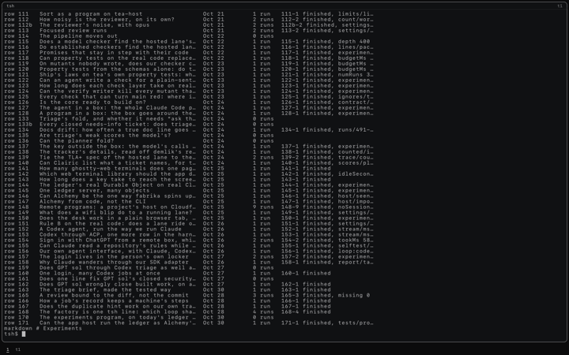
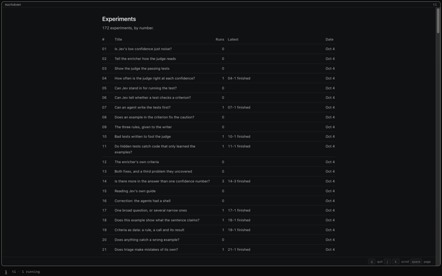

# experiments: `@tea-fabrika/experiments`

Every experiment on the ledger, as `ls` lists files: one row each, then the list as markdown,
and it ends. It reads through the `Experiments` service
([`packages/pipeline/src/experiments/`](../../packages/pipeline/src/experiments/experiments.ts))
and writes nothing. The fabrika app lists it.

```ts
import {call} from "@kampus/fabrika";
import {experiments} from "@tea-fabrika/experiments";

yield* call(experiments, {});
// {kind: "called", heard: [
//   {name: "row", value: {n: "170", title: "The experiments program", date: "2026-10-30", runs: 1,
//     latest: {run: "170.ed1e1dcf9719", label: "170-1", status: "finished", headline: {key: "agreed", value: 0.5}}}},
//   {name: "markdown", value: "# Experiments\n\n2 experiments, by number.\n\n| # | Title | Runs | Latest | Date |\n..."}]}
```

```text
tsh> experiments                   one line per row, as ls -l: number, title, day, runs, latest
row 170   The experiments program                       Oct 30        1 run   170-1 finished, agreed 0.5
tsh> experiments | markdown        the list, drawn in a window
```




## What's in it

| Import | File | What it gives |
|---|---|---|
| `@tea-fabrika/experiments` | `src/index.ts` | `experiments`, the program: no flags, no inputs, outputs `row` and `markdown`. It needs `Experiments`. |

- No machine and no window: it reads once and sends, as `seq` does. A program's view needs a
  machine, so a window would mean a machine that holds one value and never changes. Its rows
  go to `markdown` instead.
- In tsh a row prints as one line (`Experiment.toLine`): a title cut at 44 characters, the day as
  "Oct 30" (with the year when it is not this one), the whole line cut at 100. `--json` and a
  pipe still get the whole row.
