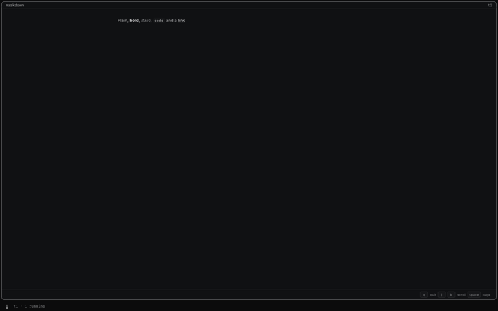

# markdown: `@tea-fabrika/markdown`

Draws any markdown it is told, as `glow` or `less` draws it in a terminal: in a window of its
own. Not for experiments alone. Each text told replaces the one shown; it ends on quit, as `q`
ends `less`. The fabrika app lists it and knows its window.

```ts
import {Root} from "@tea-fabrika/markdown/root";

Root.fromMarkdown("# Hi\n\nSome *text*, a [link](https://example.com).\n\n- a\n- b");
// {type: "root", children: [
//   {type: "heading", depth: 1, children: [{type: "text", value: "Hi"}]},
//   {type: "paragraph", children: [{type: "text", value: "Some "},
//     {type: "emphasis", children: [{type: "text", value: "text"}]}, {type: "text", value: ", a "},
//     {type: "link", url: "https://example.com/", children: [{type: "text", value: "link"}]},
//     {type: "text", value: "."}]},
//   {type: "list", ordered: false, start: null, spread: false, children: [
//     {type: "listItem", checked: null, children: [{type: "paragraph", children: [{type: "text", value: "a"}]}]},
//     {type: "listItem", checked: null, children: [{type: "paragraph", children: [{type: "text", value: "b"}]}]}]}]}
```

```text
tsh> markdown --text "Some **bold**"      a window with one line
tsh> experiment --n 170 | markdown        the page, drawn
tsh> experiment --n 404 | markdown        no window: tsh prints why experiment failed
```



## What's in it

| Import | File | What it gives |
|---|---|---|
| `@tea-fabrika/markdown` | `src/index.ts` | `markdown`, the program: flag `text`, inputs `text` and `quit`, one machine `page`, and its `view`, the blocks. No React. |
| `@tea-fabrika/markdown/root` | `src/root.ts` | `Root`, `Block` and `Inline`: markdown read into blocks, in mdast's names (the syntax tree remark uses). |
| `@tea-fabrika/markdown/window` | `src/window.tsx` | `MarkdownWindow`, its window: each block as React elements. Keys as in `less`: `q` quits, `j` `k` and the arrows scroll, space and `b` page, `g` and `G` go to the top and the end. |

- It reads with `mdast-util-from-markdown` and GitHub's extension (tables, task lists,
  strikethrough, bare links): CommonMark as GitHub reads it. Both are small, MIT, and what remark
  is built on.
- Safe by its shape, not by cleaning a string. The window draws React elements and never sets
  HTML, so there is nothing to sanitize afterwards:
  - raw HTML in the text is left out;
  - a link keeps its `href` only for `http` or `https` (the `Web` schema refuses any other), and
    opens in the person's own browser through the app's link path; the window never moves;
  - any other link, a `javascript:` one too, is drawn as its text alone;
  - an image is drawn as its alt text.
- A pipe's end does not end it: a person reads, then quits. But if its text closes with none told,
  as when the program before it failed, it ends at once and opens nothing, as `less -F` does for
  git: the person sees the error at the prompt, not an empty window.
- In a terminal, with no window, it draws nothing: tsh's printer cuts a text past 24 characters
  (experiment 170).
