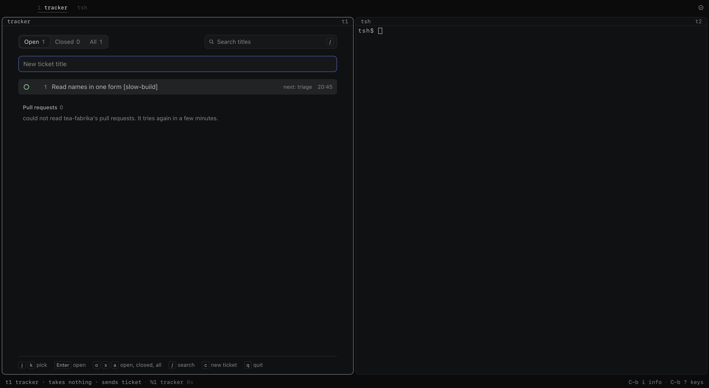
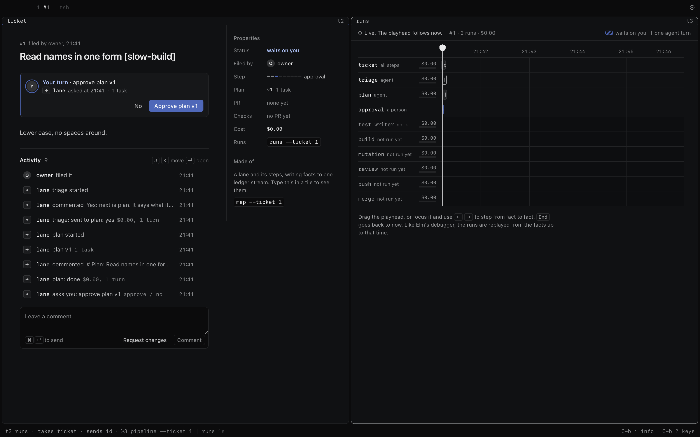
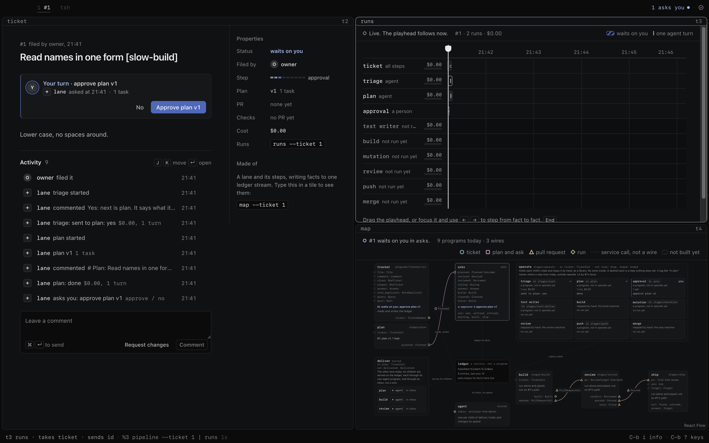
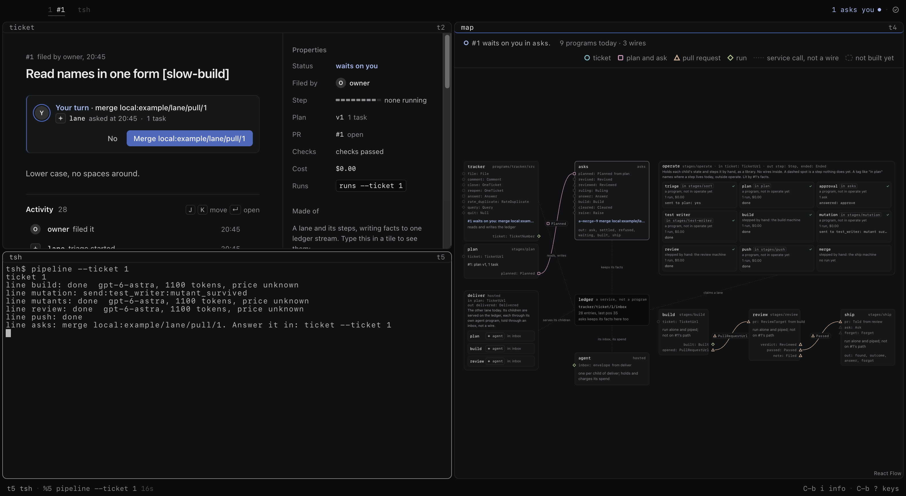
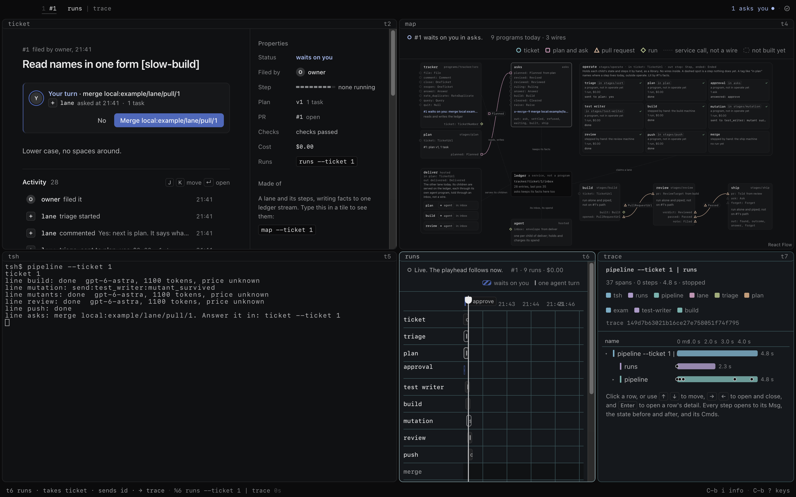
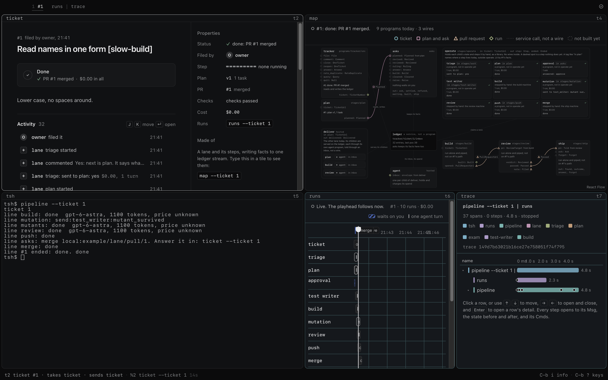
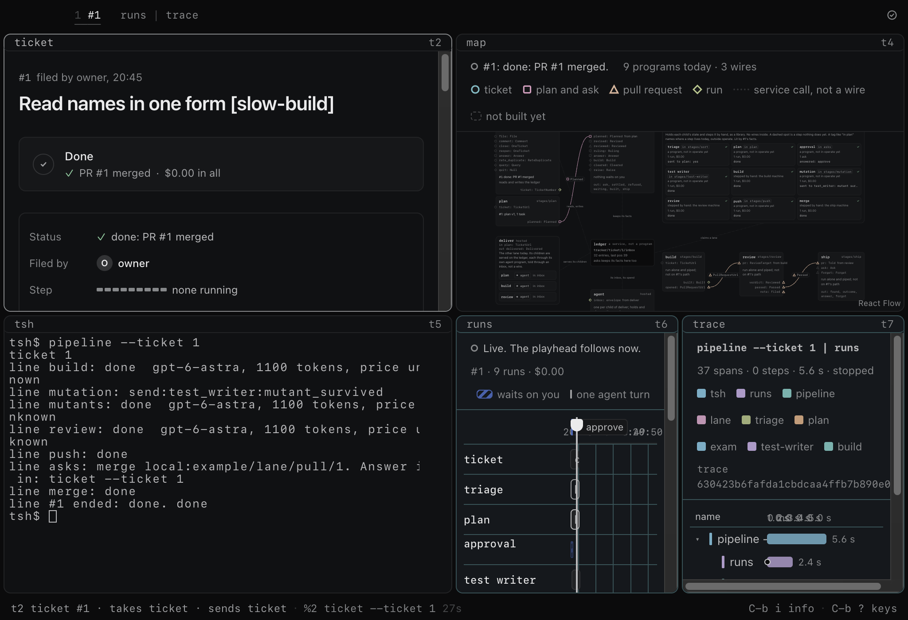
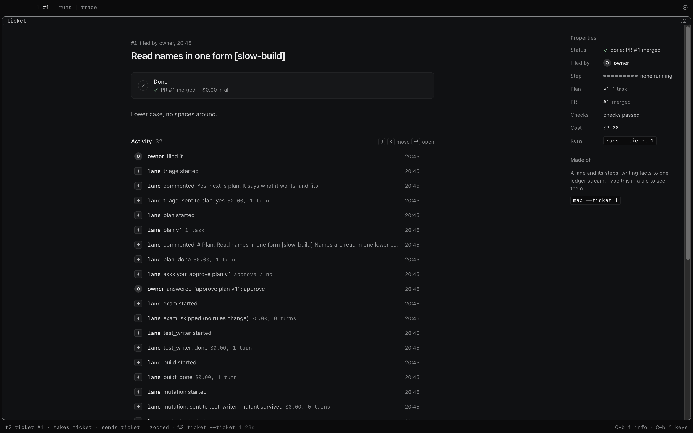
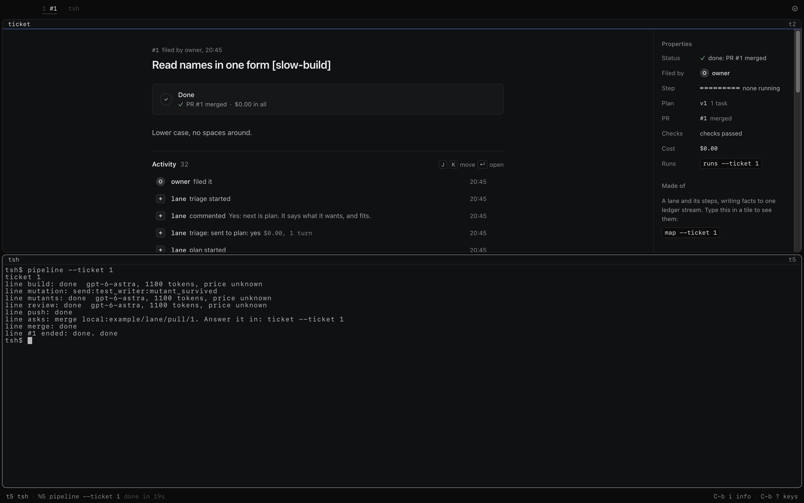

# pipeline: `@tea-fabrika/pipeline`

One line in an app tile runs one tracker ticket through every step. Today's version. Every step is
a real machine, the facts go on the ticket, and the app's own windows show them.

```text
tsh> pipeline --ticket 117            prints one line per step
tsh> pipeline --ticket 117 | runs     the runs window fills in as it goes
tsh> map --ticket 117                 another tile: the steps light up
tsh> runs --ticket 117 | trace        pick a run, see its turns
tsh> ticket --ticket 117              the asks, answered here
```

The order, in `packages/pipeline/src/stages/pipeline/machine.ts`:

```text
triage -> plan -> the person approves -> exam, when rules change -> test writer
       -> build -> mutation -> one review -> push -> the person's yes -> merge
```

## What it needs

A checkout of the repository, where the app and its host were started. `pnpm fabrika` starts them in
this one. When a lane starts it reads that checkout's `origin`, as written in git's config, the way
`gh` reads the folder it runs in. No file names the repository: its address is the repository's own
fact, and the app's home holds only the person's things
([one fabrika.toml per repo](../../docs/direction/one-fabrika-toml-per-repo.md)).

```text
https://github.com/acme/web.git    acme/web, on the GitHub host
git@github.com:acme/web.git        the same
/srv/git/acme/web.git              acme/web, on the local host: a bare git remote and a file of pull requests, for proof
https://gitlab.com/acme/web.git    refused: the lane ends before any agent starts, and says why
no origin, or no checkout          refused the same way
```

Only `origin` is read. `gh` picks among several remotes by name, `upstream` first, then `github`, then
`origin` (`remoteNameSortScore` in `context/remote.go` of `cli/cli`), because it reads and opens pull
requests against a fork's parent. The lane pushes branches and merges, so it works where git itself
pushes by default: `origin`. The lane runs the `codex` on the path. The repository holds
`.fabrika/fabrika.toml`, with `[[checks.run]]`, one `[agents.<step>]` table per step you want to
change, and its review rules in `[review]`. Each step defaults to Codex on `gpt-6-astra`, effort
`high`. Triage defaults to `claude` on `opus`.

`[review] rubrics` names a folder, read from a copy of main's tip, so a change's files cannot rewrite
the rubrics that judge it. Left out, the lane uses the rubrics fabrika ships. This holds on both hosts.

The same goes for what an agent loads by itself. In the copy of a head that the test writer, the
mutants step and the review read, these are main's, or gone when main has none, at any depth and in any
case or compatibility form of the name: `AGENTS.md`, `AGENTS.override.md`, `CLAUDE.md`,
`CLAUDE.local.md`, `.mcp.json`, `.codex/`, `.agents/`, `.claude/`. A change to one still shows in the
review's diff. The tests run in the head's own copy, so they see the head's files.

**Run the lane only on work from agents you trust.** The judge's copy stops a head's files from telling
its judge how to judge. It does not stop a head's running code. The install, the checks and the mutants
run with no box, as you. They have no login in their environment, but they can reach what you can reach.

The lane's git runs with your ssh agent's socket and your `gh` login in reach, as the build's does, so
a `git@` remote works. Git's hooks are off. The clone's git config is not held: a head's install or
checks can change it, and this git obeys it.

A run on `claude` leaves its transcript in `~/.claude/projects`. The SDK writes it there, not the lane,
so a lane's home does not hold it and removing a run's home does not remove it.

## On GitHub

An `origin` on GitHub works through your own `gh`. It has run only over a stand-in `gh`
(`fixtures/pipeline-lane/gh.mjs`), never against real GitHub. Only the stand-in's answer to the facts
query is compared with a recorded one in `fixtures/code-host/`. Its other answers and all its refusals
are written from what the code expects.

- **The review stays local.** It reads the head on this machine, and its checks are `[[checks.run]]`.
  The push step then opens the pull request and posts the verdicts as comments.
- **The lane's own verdicts count.** No GitHub approval and no reviewers list is read. A verdict counts
  only at the head it was posted for. If a person pushes after that, the lane ends `stuck: sent_back`.
- **The yes is yours, on the ticket.** A GitHub approval does not stand in for it.

Which checks ship waits on, from `[checks] github` at main, read on each call:

| `github` | What ship does |
|---|---|
| `every`, or left out | Waits on every check on the head. A failed one is run again once, then the work is sent back. |
| `required` | The same as `every`: ship still waits on every check, and a failed one sends the work back. |
| `none` | Never waits on GitHub. It runs `[[checks.run]]` on this machine at the head it pushed, and those decide. A file with no `[[checks.run]]` is refused. |

Stuck words come at two levels. The lane has seven of its own (`stages/pipeline/outcome.ts`). A step's
own word, such as ship's `checks_stuck`, ends that step, and the lane then ends `stuck: step_stuck`.

- **A repository with no CI.** Under `every`, no check ever reports. Ship waits 15 minutes and ends
  `stuck: checks_stuck`, so the lane ends `stuck: step_stuck`. Set `github = "none"` in `[checks]` to get
  past this.
- **A branch rule that wants a GitHub review.** GitHub refuses the merge. Ship ends
  `stuck: merge_failed`, so the lane ends `stuck: step_stuck`. The ticket does not say which rule refused it: ship never reads the refusal's
  words.
- **Hold other merges during a run.** A commit on main that ship's last read before the merge sees means
  `behind`, even one that touches nothing of this change. The lane then ends `stuck: sent_back`, and that
  is final. After that read, the two kinds of branch differ. On a branch with no rule the merge is pinned
  to the main it read, so a commit that lands in between still means `behind`. On a branch with a rule,
  ship's merge names only the head, so ship itself does not stop on that commit. A rule that requires
  up-to-date branches may refuse the merge. A real run is what will settle that.
- **`mergeable: UNKNOWN` ends it.** If GitHub has not worked out whether the head merges when ship looks,
  ship ends `stuck: merge_unknown`, so the lane ends `stuck: step_stuck`. It does not wait and look again.
- **A flaky check can end it.** A red check's failed jobs run again once per head, if they are GitHub
  Actions runs. Under `none`, or with no such run, there is no second try. Red again sends the work back:
  `stuck: sent_back`. Then typing the line again only says how it ended. The pull request and its branch
  stay open and nothing more runs. Inside a live run nothing but ship merges. Once a lane is finished and
  stuck, what is left is a by-hand change, under the by-hand rule: the owner's yes, green CI, and an agent
  merges after a leak grep. The other choice is a new ticket.
- **The ticket shows the merge the lane made.** The ticket's `pr` fact and the row in `pulls.json` say
  `merged` from the lane's own merge, not from a read that can lag behind it. A new head on that branch
  is a new pull request.
- **A merge ship finds already done shows as GitHub reads it.** The ticket's `pr` fact holds the head that
  merged and its checks as they read. At the head the lane judged, the lane ends `done`: it cannot tell
  its own merge with a lost answer from a person's merge of that head, so red checks there show as red.
  At another head, the merge step ends `stuck: merged_elsewhere`, so the lane ends `stuck: step_stuck`,
  and the ticket says both heads.

## What it holds to

- **A ticket must be yours.** One filed by someone else is refused before any agent starts.
- **No agent approves.** The lane asks a person four kinds of question, each answered in the ticket
  window: `approve` (the plan), `exam_merge` (the exam's own pull request), `merge` (the merge yes), and
  `step` (a step ended on `ask`, and may be run again). Merge is `ship`, with its guards.
- **The builder cannot touch the exam.** A change to a file the test writer's commits touched, or to
  a rule file, ends the build in `stuck: exam_touched`, so the lane ends `stuck: step_stuck`, and the
  ticket says so.
- **Closing a window loses nothing.** Ctrl-B x, y closes the runs window and the lane goes on. A second
  Ctrl-B x, y stops it. Typing the line again goes on from the ticket, and no finished step runs twice.
- **A decision is a person's.** What they decided at the plan reaches the test writer, the builder and
  the review. A review that thinks one is wrong can say so, and it fails nothing and makes no test. The
  person reads both sides, and picks whether the decision stands or the lane stops.
- **A later round with no change is a question.** The person picks whether the work goes on as it is,
  with code's checks still ahead of it, or the lane stops. A first round with no change stays stuck.
- **Each run records its brief.** Its name and hash go on `started`, as it starts.
- **A stuck lane is final.** Typing the line again says how it ended, and runs nothing.

## What's in it

| Import | File | What it gives |
|---|---|---|
| `@tea-fabrika/pipeline` | `src/index.ts` | `pipeline`, the program: flag `ticket`, outputs `ticket` and `line`. Names no platform. |
| `@tea-fabrika/pipeline/node` | `src/node.ts` | `laneRunner(writer)`: lanes on this machine, in the host's process. |
| | `briefs/` | One plain file per step that runs an agent. The app's build copies them beside its bundle. |
| | `docs/` | Real shots from the built app, taken by `apps/fabrika/lane-e2e.ts`. |

The lane's logic is in `packages/pipeline/src/stages/pipeline/`. The write-up is
[experiment 175](../../experiments/175-pipeline-v0.md).

## Shots

| State and layout | What squeezes or looks wrong |
|---|---|
|  | The tracker says it could not read pull requests: a test home has no `gh`. |
|  | The runs window says `0 runs` while the ticket's ask waits, since it counts finished clips. |
|  | Fine. |
|  | Fine. |
|  | The map's text is too small to read at a quarter of the window. |
|  | Runs' ruler labels overlap the `approve` mark. Cost says `$0.00`: the price of `gpt-6-astra` is unknown. |
|  | Tile lines wrap hard at the edge. Trace's time ruler labels overlap, and the map is cut off below. |
|  | Fine. |
|  | Fine. |

## How Linear would do it

It adds no window. The lane is a tile line, and the ticket, runs, map and trace windows draw it, so
the ticket stays the one place a person answers. Linear would put the step list in the issue's
sidebar too; ours is the ticket window's step bar, with `runs` for the detail. Where we differ: a
person types a line to start it, not a button, because tsh is the app's way to start anything.
