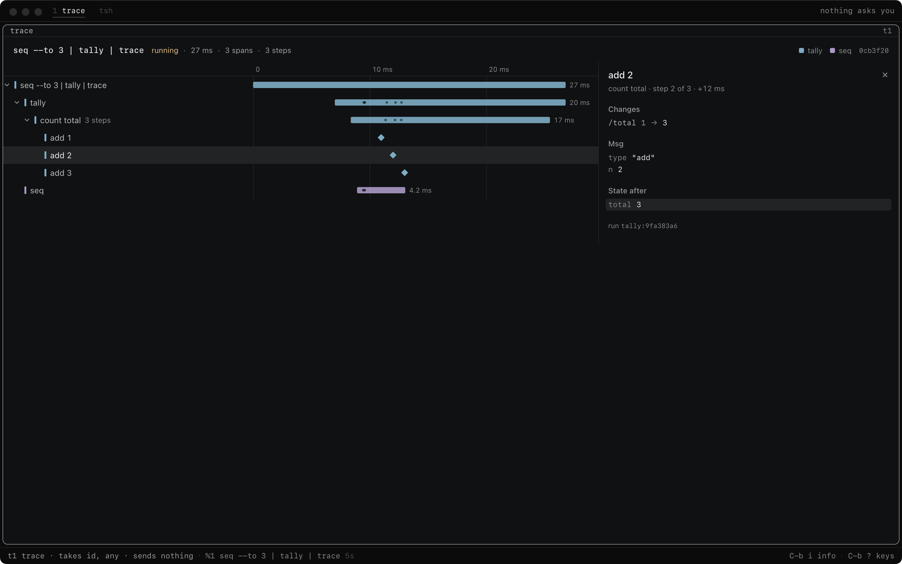

# trace: `@tea-fabrika/trace`

One job's trace in a tile of its own. It reads the job's record through the `Traces` service and
draws it as a waterfall: one bar per span, nested by parent, one colour per program, and the
events as dots. Every row that groups others opens, down to one step. A step shows what changed
first, then its Msg, the state after and the Cmds it started. The models are Elm's debugger,
Redux DevTools, and Jaeger's span detail. The design is
[A JobRecord holds each host job](../../docs/direction/a-job-record-holds-its-trace.md); the look
is [The trace window](../../docs/direction/the-trace-window.md).



```ts
// tsh> seq --to 3 | tally | trace    no flag: its own line's job, followed live as it goes
// tsh> trace --id <a trace id>       that job's record, followed while the job runs
// tsh> runs --ticket 7 | trace       its own line's job until an id comes on `id`; a newer one replaces it

// What the window sends, input by input, and what the tile shows after:
toggle {row: "span:<tally's span>"}   // tally opens: "count total"
toggle {row: "machine:[…]"}           // count total opens: add 1, add 2, add 3
choose {row: "step:[…, 2]"}           // add 2's detail:
// {name: "add 2", n: 2, of: 3, msg: {type: "add", n: 2}, before: {kind: "kept", state: {total: 1}},
//  after: {total: 3}, changes: [{op: "replace", path: "/total", before: 1, after: 3}], cmds: []}
```

The first read chooses the job's row, so the tile opens with the job's facts beside the waterfall,
as Honeycomb and LangSmith select the root span.

## The program, types first

The Elm answer: a Model, Msgs, an update, and a view of the Model. Which rows are open is in the
Model, as Elm keeps it, so a second window on the same run shows the same rows open.

```ts
// src/machine.ts
type Read =
	| {at: "waiting"}
	| {at: "reading"; id: TraceId}
	| {at: "read"; trace: JobTrace}
	| {at: "unread"; id: TraceId; why: string};

type Model = {read: Read; open: RowKey[]; chosen: RowKey | null};

type TraceMsg =
	| {type: "look"; id: string}           // follow a record: its own job's, or the flag's, then each id on `id`
	| {type: "got"; trace: JobTrace}       // the record, read again after a write to it
	| {type: "lost"; id: string; why: string} // it could not be read
	| {type: "toggle"; row: string}        // open or close a row that groups others
	| {type: "choose"; row: string | null} // show one row's detail; null closes it
	;

// No Cmd. The record changes while its job runs, so it is a Sub, as Elm's `Time.every` is:
type FollowSub = Sub<"follow", {id: string}>;
// followed(model): {id} while it reads or shows a record, null (no Sub) while waiting or unread
```

The runner reads the record through `Traces.watch`: at once, then after each write to it. A host's
own records ring on each write; records behind the door are read again every second. It stops
following 5 seconds after the job ended (`SETTLE`), once the last spans are in.

A later `got` keeps the rows open and the detail chosen, if the new record still has them. A
`got` for an id the machine no longer follows is dropped, so a slow answer never replaces a newer
pick.

## Its inputs

| Input | Takes | Why |
|---|---|---|
| `toggle` | `{row}` | The window opens or closes a row that groups others |
| `choose` | `{row}`, or `{row: null}` | The window shows one row's detail, or none |
| `quit` | `null` | The window stops the run |
| `id` | a trace id | What `runs` sends when a run is picked |
| `any` | anything (`anyInput`) | Lets trace sit at the end of any line, as `pv` sits in a Unix pipe. What comes is let go unread |

tsh feeds `any` only when no typed input fits, and then with the source's first output, as a Unix
pipe carries stdout and not stderr. So `runs | trace` still goes to `id`, and `seq --to 3 | tally
| trace` sends tally's `total` to `any`. The Elm answer is `Json.Decode.value`: a value nobody
decodes. See [An input can take anything](../../docs/direction/an-input-can-take-anything.md).

A row is named by a key from `treeOf(trace)` (`src/tree.ts`): `job`, `span:<id>`, `run:<run>`,
`turns:<span>`, `machine:[run, machine, id]`, `step:[run, machine, id, n]`. A toggle of a row
that groups nothing, or that the record does not hold, changes nothing. So does a choose of a
row the record does not hold.

The tree, as the `seq --to 3 | tally` fixture makes it:

```text
job   seq --to 3 | tally        the tsh line's span
  run seq                       a run's span, coloured by program
  run tally
    machine count total         tally's machine run, timed by its own span
      step add 1                each Msg it took
      step add 2
      step add 3
```

- A span nests under its parent. A span whose parent never came sits under the job.
- A run with no span still gets a row, so nothing in the record is left out.
- An agent's `chat` and `execute_tool` spans fold into one "N turns" row inside the span they
  ran in.
- A span with an error status, a failed run or a failed job is drawn red.

## What's in it

| Import | File | What it gives |
|---|---|---|
| `@tea-fabrika/trace` | `src/index.ts` | `trace`, the program: flag `id` (left out: its own line's job), inputs `toggle` (`{row}`), `choose` (`{row}`, or `{row: null}`), `quit` (`null`), `id` (a trace id, as `runs` sends) and `any` (anything else on a pipe, let go), and the `follow` runner over `Traces.watch`. Its view is `Shown`. |
| | `src/machine.ts` | `trace`, the machine, and `followed`, the deps of its one Sub. Pure. |
| | `src/tree.ts` | `treeOf`, `nodesOf`, `groupsOf`, `findOf`: the record as rows. Pure. |
| | `src/view.ts` | `shownOf`: the rows open, placed in time, and the chosen row's detail. `changesOf`: a JSON Patch of two states. Pure. |
| `@tea-fabrika/trace/memory` | `src/memory.ts` | `memoryTraces(records)`: `Traces` over records in memory, for tests and shots. A watch reads once. |
| `@tea-fabrika/trace/tally` | `src/tally.ts` | `TALLY_TRACE`, `TALLY_ID`: the `seq --to 3 \| tally` job, in the record's shape. |
| `@tea-fabrika/trace/window` | `src/window.tsx` | `TraceWindow`: the waterfall as a treegrid. |

## The keyboard

The rows are a WAI-ARIA treegrid. One row holds the focus at a time.

- ↑ and ↓ move. Home and End go to the first and last row.
- → opens a closed row, or moves into an open one. ← closes an open row, or moves to its parent.
- Enter and Space do what a click does: a grouped row opens or closes and shows its detail, a
  leaf shows its detail, and a second press hides it.
- Esc closes the detail.

## The window

The detail sits beside the waterfall when the tile is 880px wide or more, as Linear's side peek
does, and under it when narrower, as Chrome DevTools does. It stays in sight as the tile scrolls.
At 560px the row notes go, at 420px the legend goes.

| Layout | Shot |
|---|---|
| One tile, the job chosen | [trace-waterfall-one-tile.png](docs/trace-waterfall-one-tile.png) |
| One tile, a step | [trace-step-one-tile.png](docs/trace-step-one-tile.png) |
| One tile, a span | [trace-span-one-tile.png](docs/trace-span-one-tile.png) |
| Side by side | [waterfall](docs/trace-waterfall-side-by-side.png), [step](docs/trace-step-side-by-side.png) |
| Stacked | [trace-step-stacked.png](docs/trace-step-stacked.png) |
| 2x2 | [trace-step-grid-2x2.png](docs/trace-step-grid-2x2.png) |
| 1024x700 window | [trace-step-small-window-1024x700.png](docs/trace-step-small-window-1024x700.png) |
| Its own line's job, beside runs, before a pick | [trace-own-job-side-by-side.png](docs/trace-own-job-side-by-side.png) |
| An empty record | [beside runs](docs/trace-empty-record-side-by-side.png), [one tile](docs/trace-empty-record-one-tile.png) |

## Not done

- The laptop's records hold no runs (`JobTrace.runs` is empty): a run's state lives in the
  host's file storage. The steps and spans are there.
- A home connected to a ledger server still keeps its records on the laptop.
- trace open in its own line keeps that job running, so the follow stays live until trace quits.
- `runs --ticket 7 | trace` opens both windows side by side. A run picked whose job ran on
  another host, or whose record this laptop never kept, shows an empty record.
- The record holds no ticket, so the trace draws no link to one. Opening the ticket program from
  a trace needs a way to start another program from a window, which the desk does not have.
- The fixture's spans are written by hand in the record's shape, not caught from a real run.
- The colours are six fixed hues, given out to programs in the order they first appear. A job
  with more than six programs reuses them.
