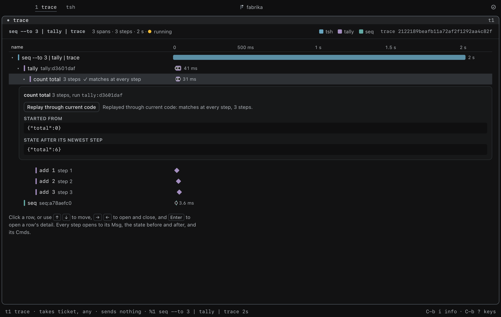
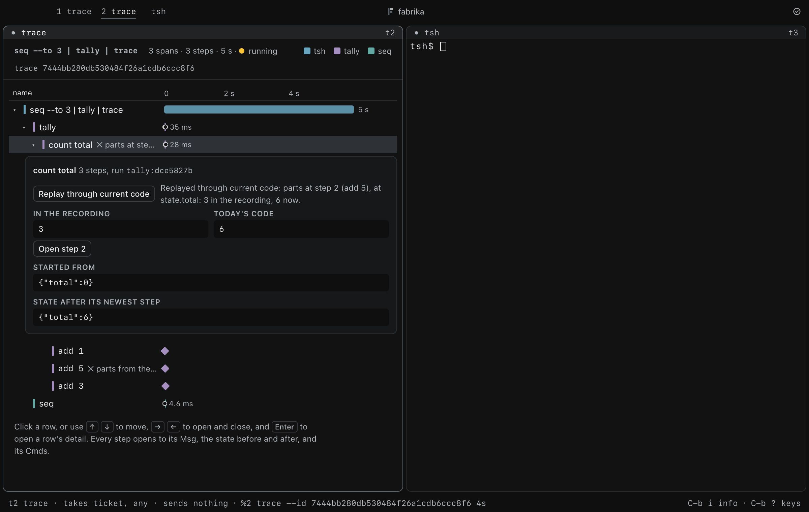

# trace: `@tea-fabrika/trace`

One job's trace, or one ticket's lanes, in a tile of its own.

- **The job view.** It reads the job's record through the `Traces` service and draws it as a
  waterfall: one bar per span, nested by parent, one color per program, and the events as dots.
  Every row that groups others opens, down to one step. A step shows its Msg, the state before and
  after, what changed, and the Cmds it started. The models are Elm's debugger, Redux DevTools, and
  Jaeger's span detail.
- **The ticket view** (ticket 141). It reads the ticket's facts through the ledger's `Tickets` and
  shows every lane the ticket ran: one section per trace id, oldest first, each on its own time
  axis. Its rows are the lane's steps and its waits on a person. A step opens to its spans, from
  that lane's job record. A fact stepper replays the ticket one fact at a time.
- **Replay through current code.** A machine run's detail in the job view has one button. It folds
  the run's recorded Msgs through today's code again, from the state each boot started from, and
  says where today's code parts from the recording, or that it matches at every step. No Cmd runs.

The design is
[A JobRecord holds each host job](../../docs/direction/a-job-record-holds-its-trace.md), and the
replay is [Replay a machine run through today's code](../../docs/plan/replay-through-current-code.md).

```ts
// tsh> seq --to 3 | tally | trace    no flag: its own line's job, followed live as it goes
// tsh> trace --id <a trace id>       that job's record, followed while the job runs
// tsh> trace --ticket 117            ticket 117's lanes, oldest first; only the newest opens
// tsh> tracker | trace               the ticket the tracker picks, then the next pick
// tsh> ticket --ticket 7 | trace     the ticket a pipe sends on `ticket`

// What the window sends in the job view, input by input, and what the tile shows after:
toggle {row: "span:<tally's span>"}   // tally opens: "count total"
toggle {row: "machine:[…]"}           // count total opens: add 1, add 2, add 3
choose {row: "step:[…, 2]"}           // add 2's detail:
// {msg: {type: "add", n: 2}, before: {kind: "kept", state: {total: 1}},
//  after: {total: 3}, changes: [{op: "replace", path: "/total", before: 1, after: 3}], cmds: []}
choose {row: "machine:[…]"}           // count total's detail, with "Replay through current code"
replay {row: "machine:[…]"}           // replayed: "matches at every step" on its row and in the detail
// or, with tally's add changed since: "parts at step 2" on its row, "parts from the recording" on add 2

// And in the ticket view:
toggle {row: "lane:<lane 1's trace id>"}   // lane 1 opens: its ruler, then a row per step and wait
toggle {row: "run:<a run>"}                // that step opens to its spans
step {by: -1}                              // ‹ : the ticket as it was one fact back
seek {at: null}                            // Live: back to now
```

## The program, types first

The Elm answer: a Model, Msgs, an update, and a view of the Model. Which rows are open is in the
Model, as Elm keeps it, so a second window on the same run shows the same rows open. What the tile
shows is one of two cases, so a ticket view never holds a stray record, and a job view never holds
a playhead.

```ts
// src/machine.ts
type Read =
	| {at: "waiting"}
	| {at: "reading"; id: TraceId}
	| {at: "read"; trace: JobTrace; now: number | null} // now: the latest tick, while the job runs
	| {at: "unread"; id: TraceId; why: string};

type Facts =
	| {at: "reading"; number: TicketNumber}
	| {at: "read"; number: TicketNumber; timeline: Entry[]}
	| {at: "unread"; number: TicketNumber; why: string};

type Shows =
	| {kind: "job"; read: Read}
	| {kind: "ticket"; facts: Facts; records: {id: TraceId; read: Read}[];
	   at: number | null;   // the playhead: null is live
	   now: number | null};

// The replay asked last: the machine run's row, its step count then, and the answer once it came.
type Replay = {row: RowKey; steps: number; answer: Replayed | null};

type Model = {shows: Shows; open: RowKey[]; chosen: RowKey | null; replay: Replay | null};

type TraceMsg =
	| {type: "look"; id: string}           // follow a record: its own job's, or the flag's, then each id on `id`
	| {type: "got"; trace: JobTrace}       // a record, read again after a write to it
	| {type: "lost"; id: string; why: string} // it could not be read
	| {type: "toggle"; row: string}        // open or close a row that groups others
	| {type: "choose"; row: string | null} // show one row's detail; null closes it
	| {type: "tick"; now: number}          // the time, while the job runs or a lane is open
	| {type: "ticket"; number: number}     // show this ticket's lanes, live
	| {type: "facts"; number: number; timeline: Entry[]} // its facts, read again
	| {type: "unread"; number: number; why: string}      // they could not be read
	| {type: "seek"; at: number | null}    // replay up to a time, or null for live
	| {type: "step"; by: -1 | 1}           // the fact before or after the playhead
	| {type: "replay"; row: string}        // replay a machine run of the record shown through today's code
	| {type: "replay_ok"; cmd; value: Replayed; at} // tea's answer to the replay Cmd
	;

// One Cmd: `replay`, carrying one machine run's starts and steps. Its handler asks the host's
// `Replayer`; with none given, the answer is {_tag: "cannot", why: "no_code"}.
type ReplayCmd = {type: "replay"; row: RowKey; starts: Start[]; steps: Step[]};

// A record and a ticket change on their own, so each is a Sub, as Elm's `Time.every` is:
type FollowSub = Sub<"follow", {id: string} | {ids: string[]}>; // one record, or one per lane
type TickSub = Sub<"tick", {id: string} | {number: number}>;
type FactsSub = Sub<"facts", {number: number}>;
// followed(model): {id} while the job view reads or shows a record, null while waiting or unread
// ticking(model): while the job shown has not ended, or while a lane is open and the playhead is live
```

### The job view

A job that has not ended says `running` in the head, and its time grows once a second (`TICK`). An
earlier tick keeps the later time, so a clock that steps back never moves it back. Its row runs to
now, and the axis with it. With no run, span or step in the record yet there is no axis and no bar:
one line says so, as Linear's empty states do. With only the line's span in (`tally &`), its row is
drawn, running to now. An ended job shows its final time, with no tick, and that time covers the
job's own, however early the line's span ended.

The job's row keeps the job's line as its name from start to end. It is tsh's row from the start,
so `tsh` stays first in the legend and each program keeps its color when the line's span comes in.

The runner reads the record through `Traces.watch`: at once, then after each write to it. A host's
own records ring on each write; records behind the door are read again every second. It stops
following 5 seconds after the job ended (`SETTLE`), once the last spans are in.

A later `got` keeps the rows open and the detail chosen, if the new record still has them. Once the
record shown says its job ended, a later `got` keeps that end and the rest of that read applies, so
a stale read never makes a job look like it runs again. A `got` for an id the machine no longer
follows is dropped, so a slow answer never replaces a newer pick.

A record keeps where each machine run started (`JobTrace.starts`), so the first step's state
before is that start, and its changes are shown against it. A record kept before starts were says
the first step's state before is the machine's start, with nothing to show.

### Replay through current code

- **The button is in the machine run's detail, never in its row.** The row is a button already,
  and a button inside a button is one control to a screen reader (WAI-ARIA 1.2: a `button`'s
  children are presentational).
- **The answer is read out:** the detail's `role="status"` region says it in full ("Replayed
  through current code: parts at step 2 (add 2), at state.total: 3 in the recording, 4 now."). It
  is in the detail before the button is pressed, so its first answer is announced.
- **The rows say it in words, each answer with its own mark:** the machine run's row "✓ matches at
  every step", "✕ parts at step 2" or "⊘ no cell for step 1", and the step it names "parts from the
  recording" or "no cell in today's code", with the same mark. A replay that could not be made has
  words alone. The mark is hidden from a screen reader, since the words say it, and color is never
  the cue (WCAG 1.4.1).
- **The detail opens the step it names:** after a replay that parts or is refused, an "Open step N"
  button chooses that step's row, which a small tile has scrolled out of view under the detail.
- **The detail shows where it started:** the first start the record kept, under "Started from".
- **A machine run with no start kept has no button.** Its detail says "Recorded before starts were
  kept, so it can't be replayed." A button that could only answer no would be a dead one.
- The replay is kept while the record shown keeps that machine run's step count, and dropped by a
  look at another record or a read with more or fewer steps. An answer for a replay no longer held
  is dropped.
- The app gives trace a `Replayer` over the programs a tile's tsh lists
  (`apps/fabrika/src/tsh.ts`, `appPrograms`). Each life of a machine run, a start and the steps
  until the next one, is replayed from its own start by tea's `replayTrace`
  (`packages/fabrika/src/host/replay.ts`).
- In a narrow tile a row's replay words end in an ellipsis; the detail and the row's label say
  them whole.

The pictures are of the built app, `seq --to 3 | tally | trace` typed in it, in
`docs/trace-replay-<state>-<layout>.png`. `matches` is that job's own record. `parts`, `refused`
and `no-start` are copies of it with one thing changed in SQL (step 2's Msg made `add 5`, then
`sub 2`; the `starts` rows deleted), opened with `trace --id`: the code is the same, the record is
not. Each is in one tile, in a 1024 by 700 window (`small`), side by side with a tsh, stacked over
one, and in a 2x2.




### The ticket view

- **A lane is one trace id,** as the ticket's `started` facts give it, oldest first. A `restarted`
  belongs to the next lane that begins after it. An ask sits in the lane its `trace` names, else in
  the lane that last started a step before it.
- **Each lane has its own time axis,** counted from the lane's start. A `filed` or a `commented`
  days away never moves it.
- **Only the newest lane is open at the start.** A lane that begins later opens too. A folded lane
  is one line: its steps drawn small, how it ended in words, and its price.
- **Rows are steps and waits on a person.** A step opens to its spans, from that lane's job record:
  the span tagged `tea.lane.run` with the step's run, else the "run a step" span that overlaps the
  step most. A span's HTTP client calls fold into one "N calls" row, which opens to one row per
  call.
- **A step row shows tokens (in, cached, out), never dollars.** Dollars show only in each lane's
  line and the ticket's line, labeled "at list price". A model with no known price says "no list
  price", never $0.00. A step that ran no model is code, and has no price.
- **A bar's color is its state, with its words beside it:** running in amber, done in green, stuck
  in red, and a wait still open in the turn accent. Color is never the only cue.
- **The fact stepper** (‹ › Live) replays the ticket. A stop is a `started`, `ended`, `asked`,
  `answered` or `restarted`. Replay is truncation: the ticket at a time is its facts up to then, as
  Elm's debugger replays a history. Past the last stop is live; from live, ‹ goes to the last stop.
- **The facts are polled.** No `Tickets.watch` exists, so the `facts` runner reads the ticket every
  second (`FAST`), and every 5 seconds (`SLOW`) once 5 reads in a row (`CALM`) changed nothing. A
  change goes back to every second. A read that changed nothing sends no Msg.
- **Each lane's record is followed** in one `follow` Sub (`ids`), since tea's `subs` is a fixed list
  and a ticket's lanes are not. A `got` for an id that is no lane's is dropped.

## Its inputs and flags

| Input | Takes | Why |
|---|---|---|
| `toggle` | `{row}` | The window opens or closes a row that groups others |
| `choose` | `{row}`, or `{row: null}` | The window shows one row's detail, or none |
| `seek` | `{at}`: a time in Unix ms, or `null` | The replay's playhead; `null` is live |
| `step` | `{by: -1}` or `{by: 1}` | The fact stepper's ‹ and › |
| `replay` | `{row}`: a machine run's row | The window replays that machine run through today's code |
| `quit` | `null` | The window stops the run |
| `id` | a trace id | A job's record to show: it replaces what shows |
| `ticket` | a ticket number | A ticket to show: what `tracker`, `ticket` and `pipeline` send |
| `any` | anything (`anyInput`) | Lets trace sit at the end of any line, as `pv` sits in a Unix pipe. What comes is let go unread |

The flags are `id` (a trace id) and `ticket` (a ticket number). With neither, trace shows its own
line's job until an id or a ticket comes in.

tsh feeds `any` only when no typed input fits, and then with the source's first output, as a Unix
pipe carries stdout and not stderr. So `tracker | trace` goes to `ticket`, and `seq --to 3 | tally
| trace` sends tally's `total` to `any`. The Elm answer is `Json.Decode.value`: a value nobody
decodes. See [An input can take anything](../../docs/direction/an-input-can-take-anything.md).

In the job view, a row is named by a key from `treeOf(trace)` (`src/tree.ts`): `job`, `span:<id>`,
`run:<run>`, `turns:<span>`, `machine:[run, machine, id]`, `step:[run, machine, id, n]`. In the
ticket view, a row is `lane:<trace id>`, `run:<run>` (a step), `ask:<ask>` (a wait), `span:<id>` or
`calls:<span>`. A toggle of a row that groups nothing, or that is not shown, changes nothing. So
does a choose of a row that is not shown.

The job view's tree, as the `seq --to 3 | tally` fixture makes it:

```text
job   seq --to 3 | tally        the tsh line's span
  run seq                       a run's span, colored by program
  run tally
    machine count total         tally's machine run, timed by its own span
      step add 1                each Msg it took
      step add 2
      step add 3
```

- A span nests under its parent. A span whose parent never came sits under the job.
- A run with no span still gets a row, so nothing in the record is left out.
- An agent's `chat` and `execute_tool` spans fold into one "N turns" row inside the span they
  ran in.
- A span with an error status, a failed run or a failed job is drawn red.

## What's in it

| Import | File | What it gives |
|---|---|---|
| `@tea-fabrika/trace` | `src/index.ts` | `trace`, the program: flags `id` and `ticket`, inputs `toggle`, `choose`, `seek`, `step`, `replay`, `quit`, `id`, `ticket` and `any`, and the runners: `follow` over `Traces.watch`, `tick`, and `facts`, the poll over `Tickets.read`, and the `replay` Cmd's handler over the `Replayer`. Its view is `Shown`. |
| | `src/machine.ts` | `trace`, the machine, `followed` and `ticking`, the deps of its Subs, and `replayCmd`. Pure. |
| | `src/tree.ts` | `treeOf`, `nodesOf`, `groupsOf`, `findOf`: a job's record as rows. Pure. |
| | `src/ticket.ts` | The ticket view's fold. `lanesOf`: the lanes from the facts up to a time. `stopsOf`: the times the stepper stops at. `childrenOf`: the spans under one step, from its lane's record, indexed once per record in a memo keyed on its spans, outside the Model. `summaryOf`: what a lane's line and the ticket's line say. Pure. |
| | `src/ruler.ts` | `ticksOf`: the ruler's ticks, ranked, for both views. Rank 1 is at most 4 ticks, rank 2 at most 8, rank 3 at most 16. The CSS shows rank 2 from a 480px ruler and rank 3 from 960px, so each label has 60px. Pure. |
| | `src/view.ts` | `shownOf`: the rows open, placed in time, and the chosen row's detail, for either view. `changesOf`: a JSON Patch of two states. Pure. |
| | `src/t117.ts` | A made-up ticket in ticket 117's shape, for the ticket view's tests: three lanes, a restart, three waits. Ids, times and tokens are made up. |
| | `src/timelines.ts` | Generators of made-up ticket timelines for the ticket view's laws, each with what is true of it written down as it is made. |
| `@tea-fabrika/trace/memory` | `src/memory.ts` | `memoryTraces(records)`: `Traces` over records in memory, for tests and shots. A watch reads once. |
| `@tea-fabrika/trace/tally` | `src/tally.ts` | `TALLY_TRACE`, `TALLY_ID`: the `seq --to 3 \| tally` job, in the record's shape, kept before starts were. `TALLY_STARTED`: the same record with count total's start kept. |
| `@tea-fabrika/trace/window` | `src/window.tsx` | `TraceWindow`: the waterfall, or the ticket's lanes, as a treegrid. |

## The keyboard

The rows are a WAI-ARIA treegrid. One row holds the focus at a time.

- ↑ and ↓ move. Home and End go to the first and last row.
- → opens a closed row, or moves into an open one. ← closes an open row, or moves to its parent.
- Enter and Space do what a click does: a grouped row opens or closes and shows its detail, a
  leaf shows its detail, and a second press hides it.

## Not done

- The laptop's records hold no runs (`JobTrace.runs` is empty): a run's state lives in the
  host's file storage. The steps and spans are there.
- A home connected to a ledger server still keeps its records on the laptop.
- trace open in its own line keeps that job running, so the follow stays live until trace quits.
- A host that dies with a job running writes no end, so that record says `running`, and its time
  grows, for as long as it is shown.
- A lane whose job ran on another host, or whose record this laptop never kept, shows its steps
  from the facts, and no spans under them.
- A step written before the pipeline tagged its "run a step" span with `tea.lane.run` finds its
  spans by time overlap, which can pick the wrong span when two steps overlap.
- The ticket's facts are polled, not watched: on a quiet ticket a change shows up to 5 seconds
  late.
- A job record holds no ticket, so the job view draws no link to one. Opening the ticket program
  from a trace needs a way to start another program from a window, which the desk does not have.
- The fixtures' spans and facts are written by hand in the record's shape, not caught from a real
  run.
- The job view's colors are six fixed hues, given out to programs in the order they first appear. A
  job with more than six programs reuses them.
- Records written before starts were kept cannot be replayed. A restart that booted from a state
  the step before it did not leave (a crash between a step's write and its save) replays on from
  that start; no row shows that start yet.
- A lane's stage programs run in the pipeline's own runner, not in tsh's list, so their machine
  runs answer that no code is listed for them.
- A Msg or Cmd whose JSON is not itself (a `Date`, a class) replays as its JSON, so a replay can
  part where the live run did not. The answer names the path and both values.
