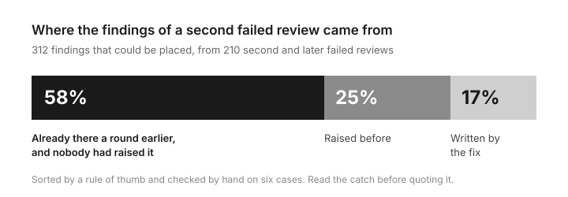

# When an agent's review fails a second time, most of what it finds was already there the first time

An agent builds a change, an agent reviews it, the review fails, the builder
fixes it, the review fails again. The easy story is that the builder did not
fix it properly. That was the smaller part. More than half of the time, the
second review was pointing at something that had been sitting there all along.

## How we know

- We read 707 failed reviews that agents wrote on the pull requests of a
  public repo. 218 of them were a second or later failed review on the same
  pull request.
- For 210 of those we took the exact change between the two rounds, then
  looked at what each finding quotes: a line the fix wrote, a line an earlier
  review had already quoted, or neither.
- 312 findings could be placed that way. 181 (58%) quote text that was already
  in the pull request a round earlier and that no earlier review had raised.
  79 (25%) had been raised before. 52 (17%) were about lines the fix wrote.

## The catch

The 58% does not hold. It came from a rule of thumb.
[Experiment 57](../experiments/57-repeat-findings-read-by-hand.md) then read
60 of the 181 by hand, against the code before and after the fix. About half
were really there before and missed. That is about 31% of the 312 findings
(24% to 38%), not 58%, so the title and the picture above say too much. The
rest were mostly new: lines the fix wrote, a sentence nobody touched that the
fix made false, or a conflict with the main branch, which is nobody's miss.

## So what

A limit on review rounds hides this. It stops the loop without asking why it
runs. We are trying the opposite: the first review writes the whole list, and
every later round may only check that list. See
[A review list can only shrink](../docs/direction/a-review-list-can-only-shrink.md).

The full take: [experiment 54](../experiments/54-why-reviews-fail.md), section 6.
